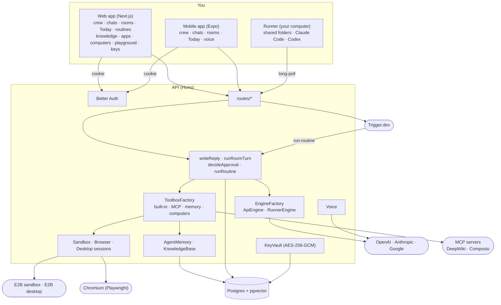

# System overview: the whole of Binary

| Box             | Chapter |
| --------------- | ------- |
| Auth, apps      | 1       |
| Database        | 2       |
| Engines, vault  | 3       |
| Characters      | 4       |
| Chat            | 5       |
| Tools, MCP      | 6       |
| Routines        | 7       |
| Approvals       | 8       |
| Sandbox         | 9       |
| Browser         | 10      |
| Runner, desktop | 11      |
| Memory          | 12      |
| Rooms           | 13      |
| Mobile, voice   | 14      |
