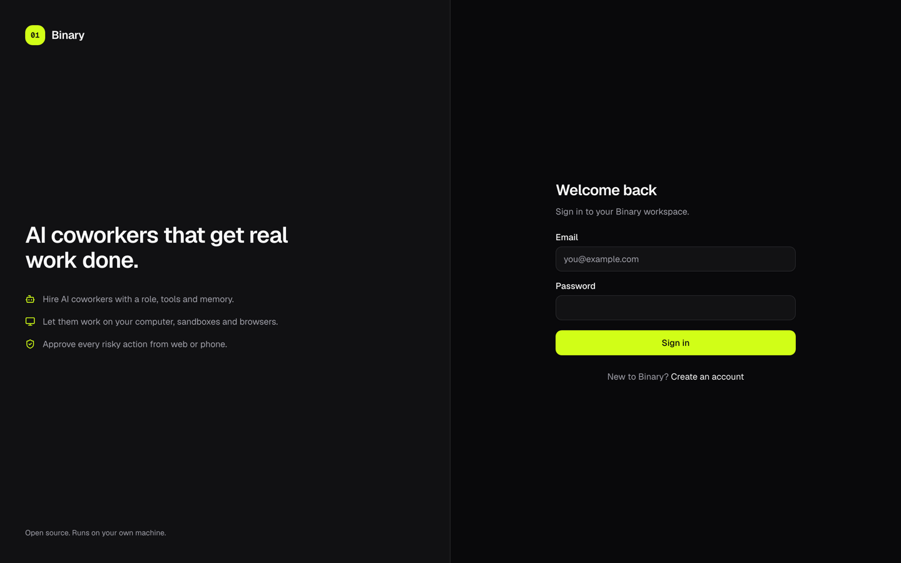

# Chapter 1: Project setup and sign-in

Binary starts as a monorepo where you can create an account and sign in, on
the web and on your phone. There's no AI yet. This chapter builds the
foundation every later feature sits on: one API, two apps, one database and
one design system.



## What you'll learn

- How a **monorepo** (pnpm workspaces + Turborepo) lets a web app, a mobile app
  and an API share code
- How **Better Auth** handles sign-up, sign-in and sessions, with cookies on
  the web and secure storage on the phone
- Why validation lives in **one shared package**, so every app shows the same
  errors
- How a **design system** (dark, one lime accent) keeps every screen consistent
- How ESLint, Prettier and CI keep the code in one style from day one

## Try it

The full walkthrough is in the [setup guide](../../SETUP.md). In short:

```bash
pnpm install
cp .env.example .env   # then set BETTER_AUTH_SECRET
pnpm setup             # starts Postgres and creates the tables
pnpm dev               # web on http://localhost:3000, API on :4000
pnpm mobile            # optional: the Expo app on your phone
```

Create an account, sign out and sign back in. Try a short password or a
wrong one to see the error messages.

## Good to know

- The API won't start while `BETTER_AUTH_SECRET` is still the placeholder.
  That's on purpose.
- On a phone, the app needs your laptop's Wi-Fi IP address, not `localhost`.

## Build it yourself

Paste [PROMPT.md](PROMPT.md) into your coding agent in an empty folder. See
[DIAGRAM.md](DIAGRAM.md) for how the pieces connect.

## Next

[Chapter 2](../chapter-02/README.md) adds a real database layer with the
Drizzle ORM and the schema for the whole app.
