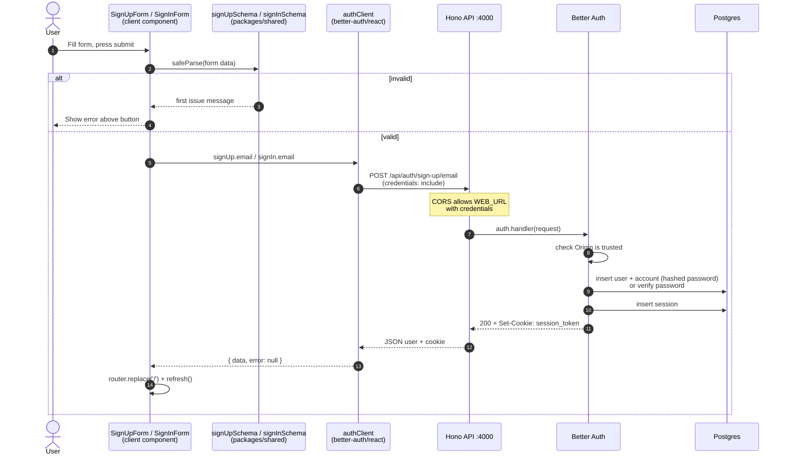
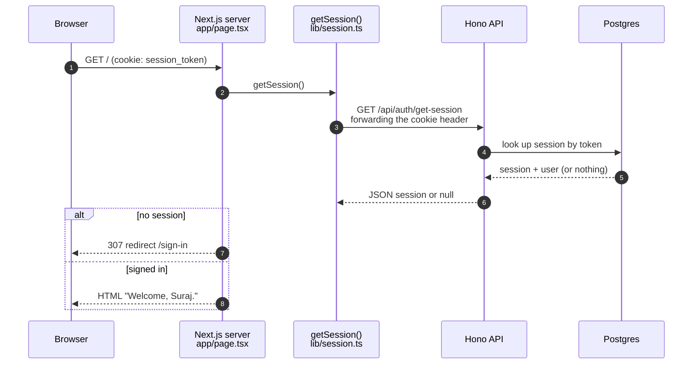
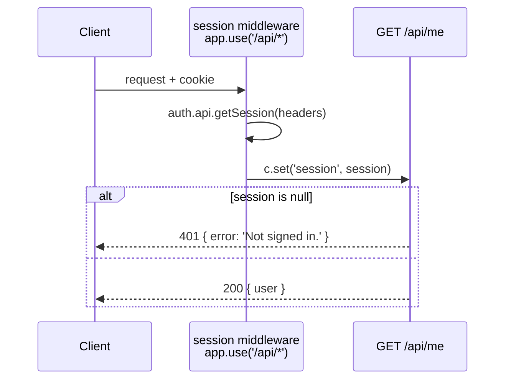

# Request flow: web sign-up, sign-in and protected page

## Sign up / sign in from the browser

## Opening the home page (server-side session check)

The browser shares cookies across ports on the same host, so the cookie set
by `localhost:4000` is also sent to `localhost:3000`. The Next.js server
forwards it to the API.

## Calling a protected API route

