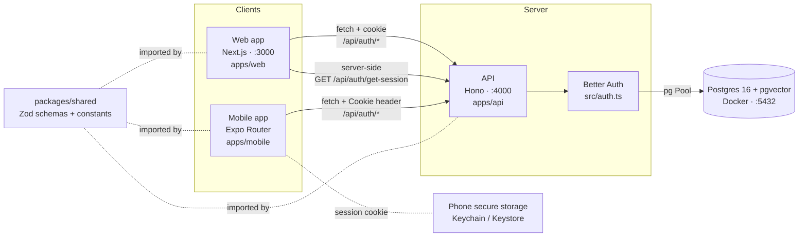
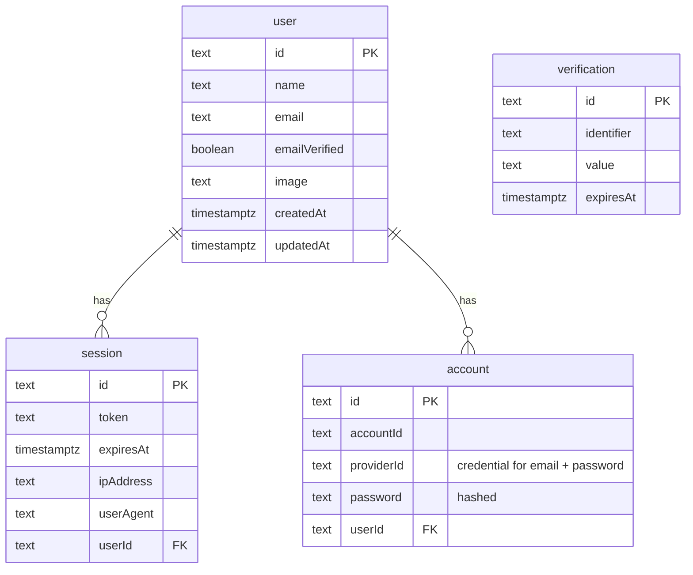

# System overview: Chapter 1

> Diagrams are Mermaid. The Jojopen MCP server was not connected in the
> session that built this chapter, so Mermaid (the documented fallback) is used.
> GitHub, Cursor and VS Code render these blocks directly.

## Components

## Database (created by Better Auth)

`verification` is unused in Chapter 1. It is created now because Better Auth
needs it for email verification and password reset later.
