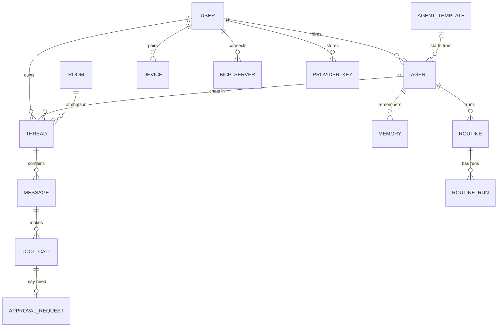

# Chapter 2 diagram

The main tables, grouped around the user. Every later chapter fills in one
part of this map. Auth's session and account tables, and a few join tables,
are left out to keep it readable.

