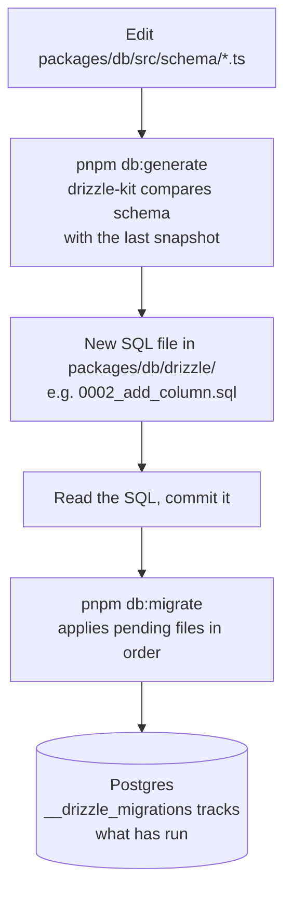
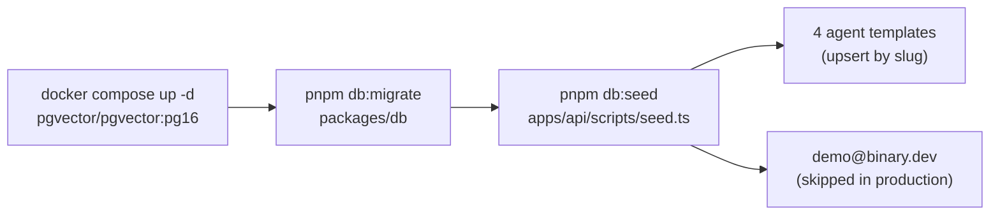
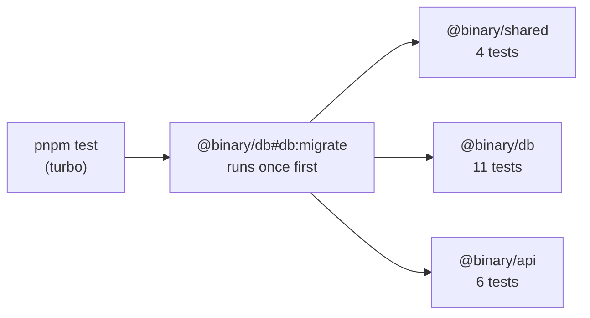

# Integration flow: schema changes, setup and tests

## Changing the schema (developer workflow)

Migrations shipped in this chapter:

| File                       | What it does                                                                               |
| -------------------------- | ------------------------------------------------------------------------------------------ |
| `0000_enable-pgvector.sql` | `CREATE EXTENSION IF NOT EXISTS vector` (hand-written)                                     |
| `0001_initial-schema.sql`  | All 16 enums and 24 tables, foreign keys, indexes, the thread check constraint (generated) |

## `pnpm setup` on a new machine

## `pnpm test`

Migrating once before any test package starts avoids two packages creating
the same tables at the same time on a fresh CI database.
