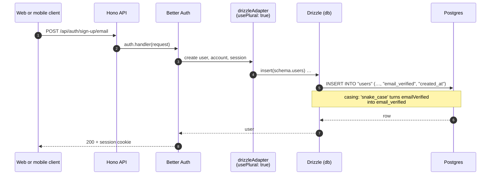
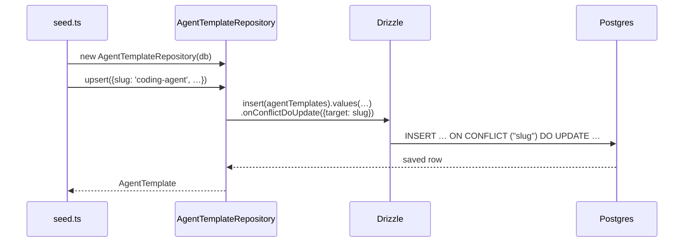

# Request flow: sign-up through Drizzle, and a repository call

## Sign-up now goes through the Drizzle adapter

Nothing changed for the web and mobile apps: same endpoints, same cookie.
Only the storage underneath moved from Better Auth's own SQL to Drizzle.

## A repository call (used by the seed today, by the API in later chapters)

The repository is the only place that knows the query. Callers get typed
objects (`AgentTemplate`) and never write SQL.
