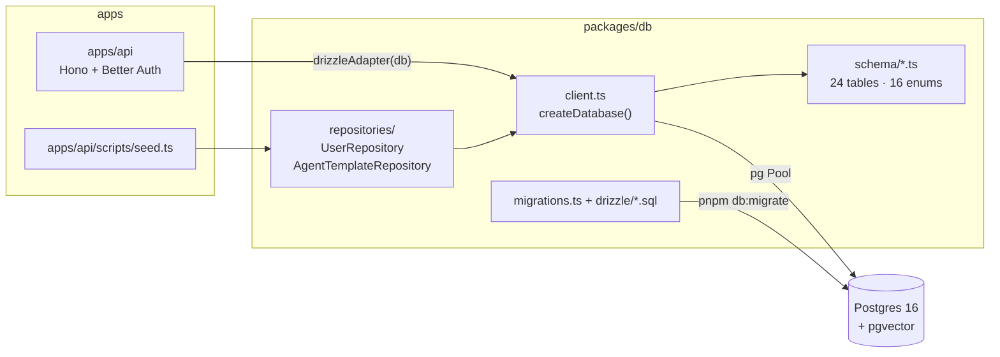
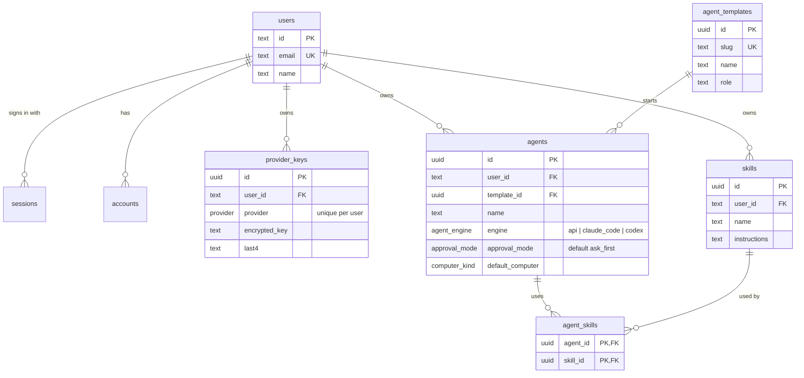
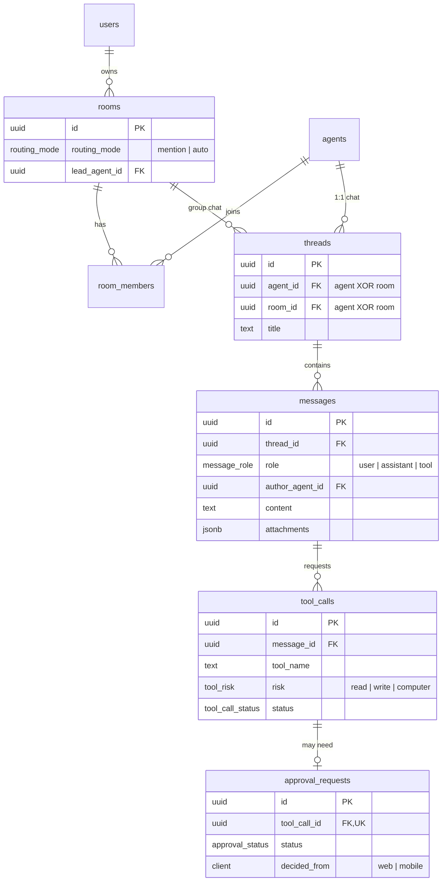
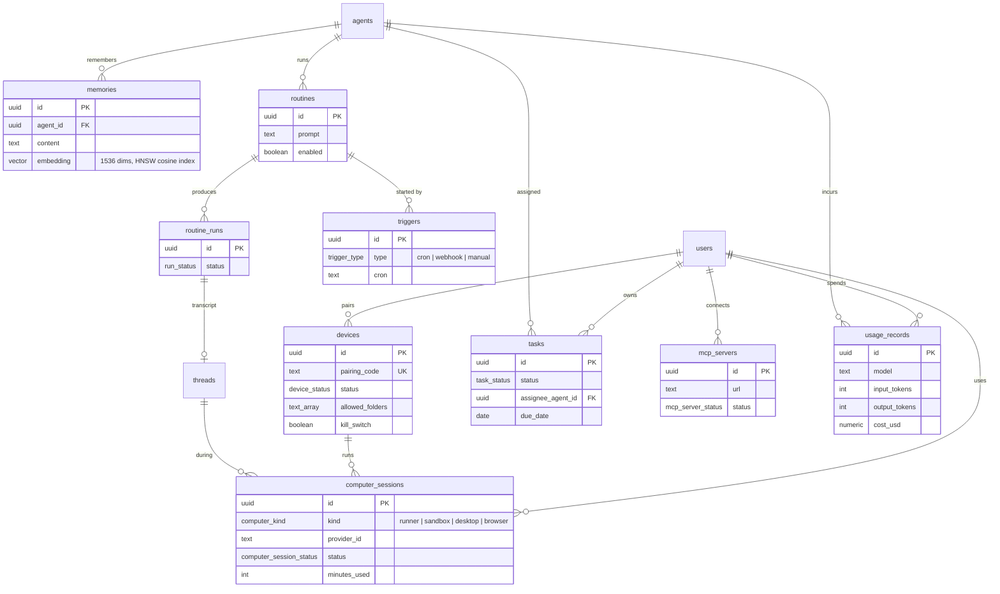

# System overview: Chapter 2

> Mermaid diagrams (Jojopen was not connected in the session that built this
> chapter; Mermaid is the documented fallback).

## Where the database layer sits

## Data model 1 of 3: identity, agents and skills

`verifications` (Better Auth) has no relations and is left out.

## Data model 2 of 3: chat, tools and approvals

## Data model 3 of 3: computers, memory, automation, integrations

