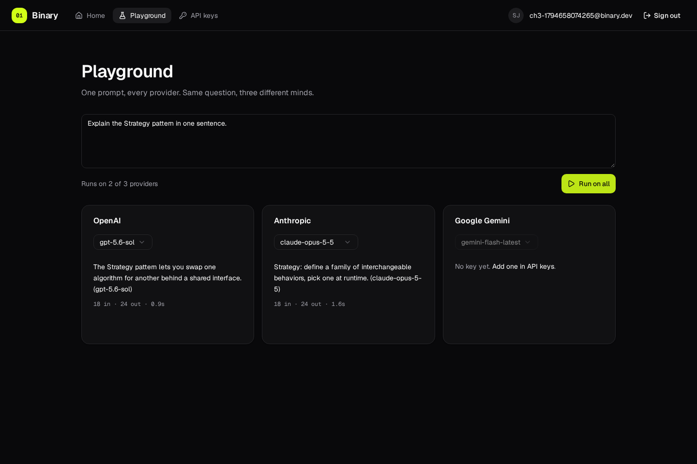

# Chapter 3: AI engine layer and API key vault

**Goal:** users bring their own OpenAI, Anthropic or Gemini key, Binary
stores it encrypted, and one engine interface can answer with any of them.
The proof: the same prompt answered by three providers, side by side.



## What you get

- **Key vault:** AES-256-GCM encryption for users' API keys, with a master
  key in `ENCRYPTION_KEY`. Tampered data or the wrong master key fails loudly.
- **API keys page** (`/settings`): add, replace or remove a key per provider;
  only the last 4 characters are ever shown.
- **Engine layer:** the `AgentEngine` interface (Strategy), `ApiEngine` on the
  Vercel AI SDK, a one-line-per-provider model factory, and `EngineFactory`
  (Factory) that finds, decrypts and uses the user's key.
- **Composition root:** `createDependencies()` wires everything once; tests
  swap in a fake model.
- **Playground** (`/playground`): one prompt, run on every connected
  provider in parallel, each with its own model picker, answer, token count
  and time.
- **App shell:** a shared header with navigation for every signed-in page.
- **Robustness fixes:** pages and forms now show a clear message instead of
  crashing or hanging when the API is unreachable.

## Files in this chapter's docs

| File                                   | What's in it                                                    |
| -------------------------------------- | --------------------------------------------------------------- |
| [IMPLEMENTATION.md](IMPLEMENTATION.md) | Plan, acceptance criteria, file-by-file, decisions              |
| [ARCHITECTURE.md](ARCHITECTURE.md)     | Engine layer, key security, API contracts                       |
| [TESTING.md](TESTING.md)               | Tests and results                                               |
| [PR_REVIEW.md](PR_REVIEW.md)           | Review findings and fixes                                       |
| [REBUILD_PROMPT.md](REBUILD_PROMPT.md) | Standalone prompt to rebuild this chapter                       |
| [architecture/](architecture)          | Components, class diagram, request flows, encryption and wiring |
| [screenshots/](screenshots)            | Playground, API keys (desktop + phone)                          |

## Run it

Add a master key to the root `.env` (new in this chapter):

```bash
openssl rand -base64 32   # paste as ENCRYPTION_KEY=...
pnpm dev
```

Open http://localhost:3000 → **API keys**, paste at least one provider key,
then open **Playground**.

> Keep `ENCRYPTION_KEY` safe and never change it on a running install: keys
> saved with the old value can no longer be decrypted, and users would have
> to add them again.

## What comes next

Chapter 4 adds agents: each one picks a provider and model from the keys
connected here, and thinks through the same `EngineFactory`.
