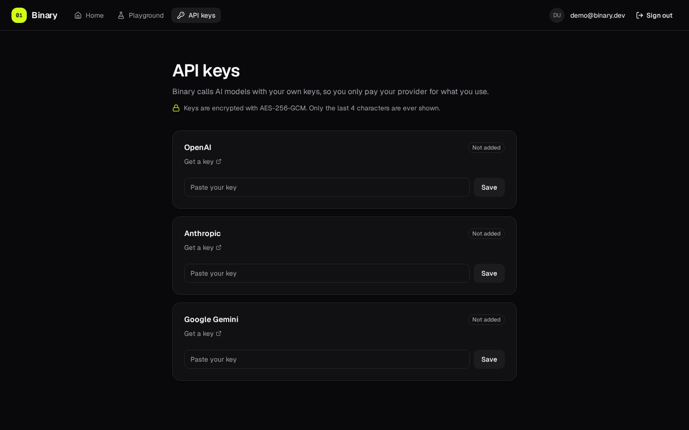

# Chapter 3: The AI engine and key vault

Binary can now talk to real AI models. You add your own OpenAI, Anthropic or
Gemini key, Binary stores it encrypted, and one engine layer can answer with
any of them. The Playground proves it: the same prompt, answered by each
provider side by side.


## What you'll learn

- How **AES-256-GCM** encrypts secrets at rest, and why it also detects
  tampering
- The **Strategy pattern**: one engine interface, so the rest of the app
  doesn't care which model answers
- The **Factory pattern**: one place that finds your key, decrypts it and
  builds the engine
- How the **Vercel AI SDK** talks to three providers through one API
- Why a **composition root** (all wiring in one place) lets tests use a fake
  model instead of real keys

## Try it

Add a master key to the root `.env` first. It's new in this chapter:

```bash
openssl rand -base64 32   # paste the result as ENCRYPTION_KEY=...
pnpm dev
```

Open http://localhost:3000, go to **API keys** and paste at least one key.
Then open **Playground**, write a prompt and press **Run on all**.



## Good to know

- **Never change `ENCRYPTION_KEY` once you've saved keys.** Keys saved with
  the old value can't be decrypted any more, and you'd have to add them again.
- You only need one provider key to follow along. Providers without a key
  show "No key yet" in the Playground.
- Model ids change often. If a provider rejects a model, pick another one in
  the dropdown.

## Build it yourself

Paste [PROMPT.md](PROMPT.md) into your coding agent in your chapter 2 repo.
See [DIAGRAM.md](DIAGRAM.md) for how a key and a prompt flow through the API.

## Next

[Chapter 4](../chapter-04/README.md) adds agents, played by cartoon
characters you hire and talk to.
