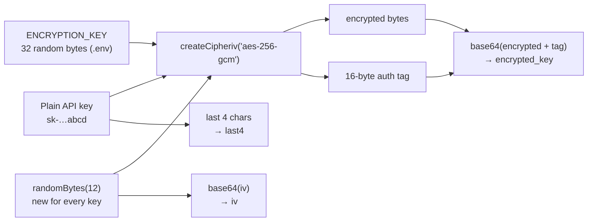
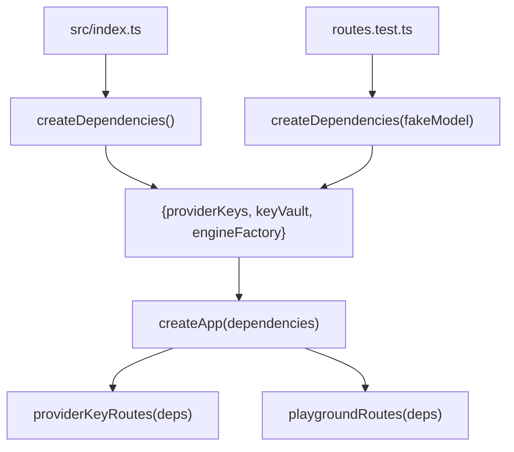
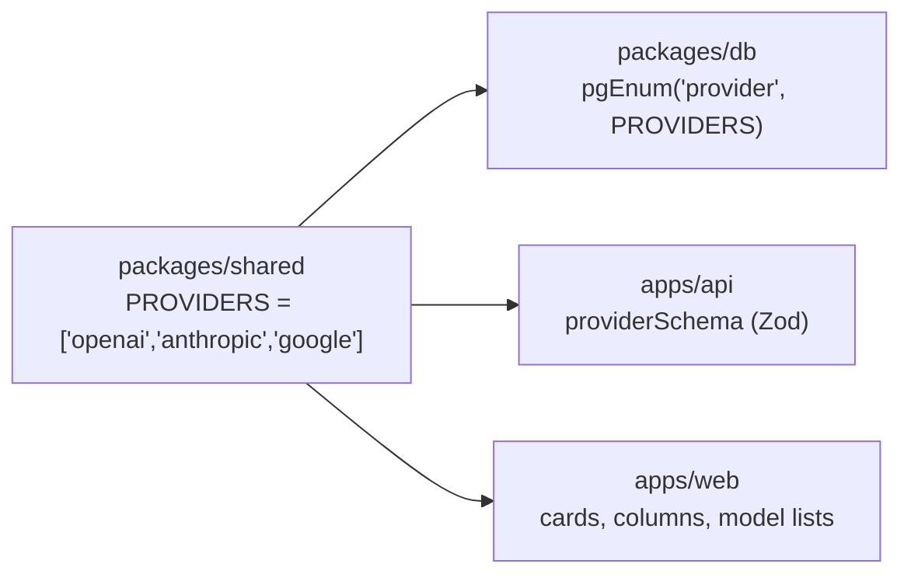

# Integration flow: encryption and wiring

## How a key is encrypted (AES-256-GCM)

Decrypting splits the tag off again. If a single byte of the stored data
changes, or the wrong `ENCRYPTION_KEY` is used, decryption throws.

## Composition root

Real and test apps are built the same way; only the model factory differs.
That is why the tests never call a real provider and never need a real key.

## Shared provider list

