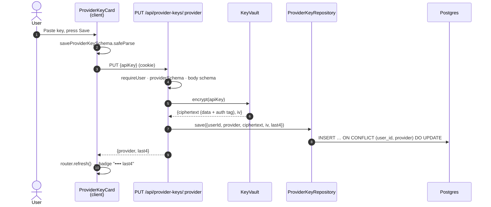
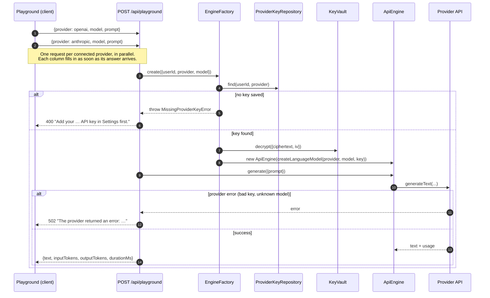

# Request flow: saving a key and running the playground

## Saving an API key

The plain key exists only in this one request's memory. The response,
the list endpoint and the database never contain it.

## Running one prompt on every provider

