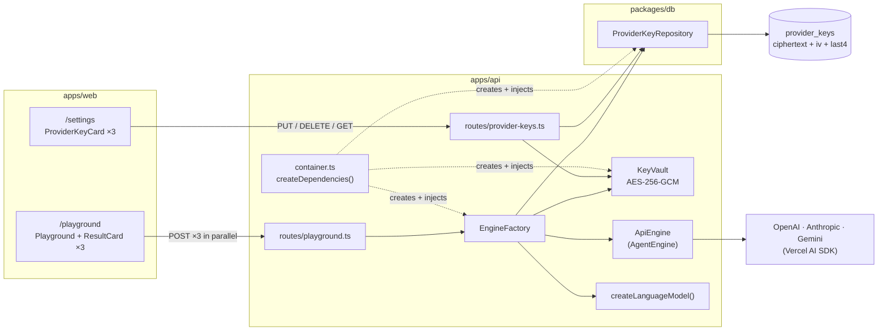
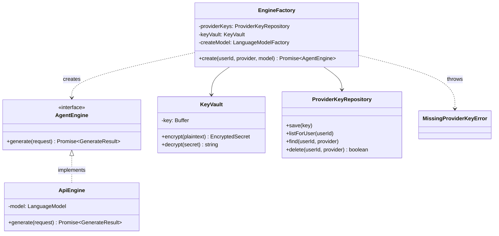

# System overview: Chapter 3

> Mermaid diagrams (Jojopen was not connected in the session that built this
> chapter; Mermaid is the documented fallback).

## Components

## Strategy and Factory

`ClaudeCodeEngine` and `CodexEngine` (Chapter 11) will implement the same
`AgentEngine` interface, so nothing that calls `generate()` changes.
