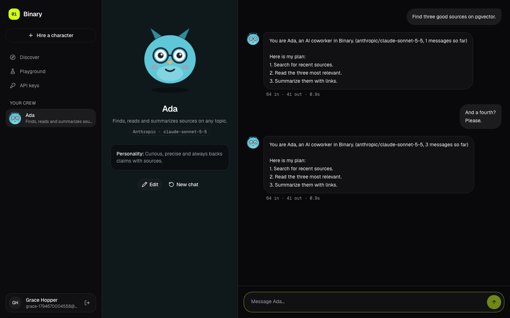
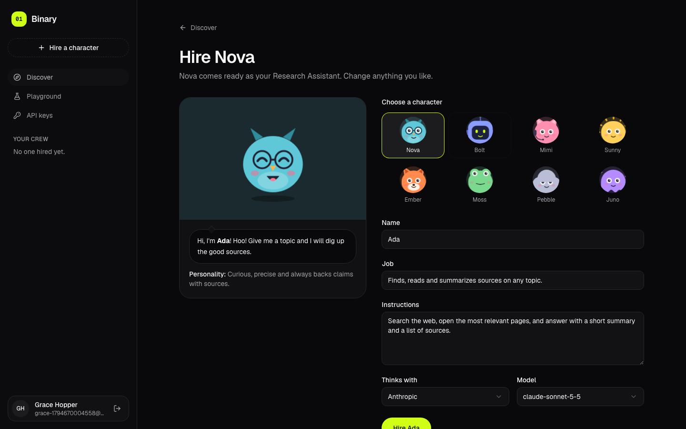
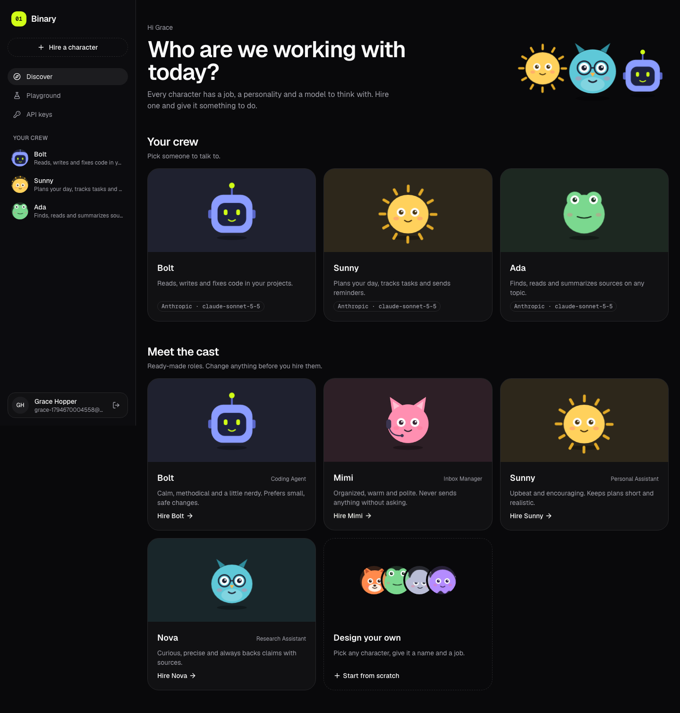
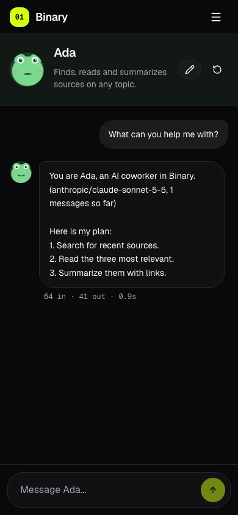
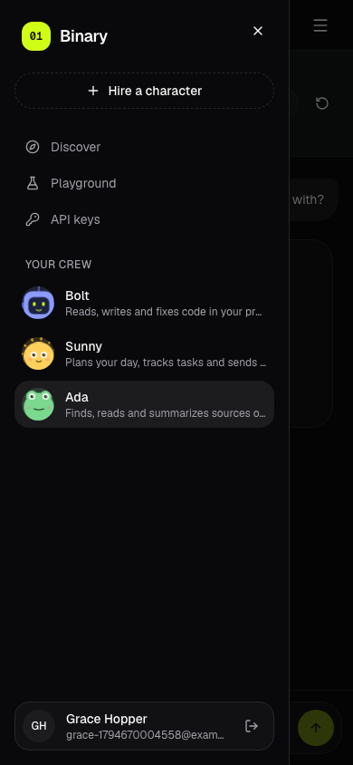

# Chapter 4, part 2: Characters

**Goal:** make the characters the centre of Binary, not a dashboard with
avatars added. Every agent is played by a cartoon character with a face, a
personality and moods. You meet them on Discover, pick them in a character
creator, and talk to them on a stage that reacts to the conversation.

## Research that shaped it

- **Grok companions** show a companion in its own pane, where it moves and
  reacts while it talks, and pick companions from a top-left menu. Binary
  borrows the _pattern_: a character stage beside the chat, and a sidebar
  with your crew. The characters are original. Grok's are 3D, and some are
  sexualized, which doesn't fit AI coworkers.
- **Companion apps** do well with a curated roster of characters with
  distinct personalities and a consistent look. Avatars whose mood follows
  the conversation are the common way to make them feel alive.

## What changed

| Area        | Before (part 1)                   | Now                                                                                                          |
| ----------- | --------------------------------- | ------------------------------------------------------------------------------------------------------------ |
| Identity    | Initials in a grey circle         | 8 original SVG characters, each with a silhouette, color, personality and 5 moods                            |
| Navigation  | Top header with 4 links           | Sidebar: Discover, Playground, API keys, **Your crew** (one click to chat), profile. Drawer on phones        |
| Home        | Next-step card                    | **Discover**: hero cast, Pebble asks for a key, "Your crew" cards, "Meet the cast" (templates as characters) |
| Hiring      | Plain form                        | **Character creator**: live preview greets you by the name you type; pick from 8 characters                  |
| Agent page  | Single-message box + profile form | **Conversation**: character stage reacting to the chat, multi-turn messages, starters, Enter to send         |
| Editing     | Inline on the agent page          | `/agents/:id/edit`, the same creator; "Fire" lives here                                                      |
| Personality | —                                 | The character's personality is added to the system prompt                                                    |

## The cast

| Id       | Name   | Look                                | Plays (template)   | Personality                                                       |
| -------- | ------ | ----------------------------------- | ------------------ | ----------------------------------------------------------------- |
| `nova`   | Nova   | Teal owl, round glasses, beak       | Research Assistant | Curious, precise and always backs claims with sources.            |
| `bolt`   | Bolt   | Periwinkle robot, lime antenna      | Coding Agent       | Calm, methodical and a little nerdy. Prefers small, safe changes. |
| `mimi`   | Mimi   | Pink cat with a headset             | Inbox Manager      | Organized, warm and polite. Never sends anything without asking.  |
| `sunny`  | Sunny  | Yellow sun with slowly turning rays | Personal Assistant | Upbeat and encouraging. Keeps plans short and realistic.          |
| `ember`  | Ember  | Orange fox                          | —                  | Bold and energetic. Gets straight to the point.                   |
| `moss`   | Moss   | Green frog                          | —                  | Patient and gentle. Explains things step by step.                 |
| `pebble` | Pebble | Lilac cloud, half-closed eyes       | — (fallback)       | Quiet, thoughtful and a bit dry-witted.                           |
| `juno`   | Juno   | Purple ghost with sparkles          | —                  | Dreamy and creative. Full of unexpected ideas.                    |

Moods: **idle** (floats, blinks), **thinking** (looks up, thought dots),
**talking** (mouth moves), **happy** (closed-eye smile, rosy cheeks),
**oops** (worried brows, sweat drop).

## How it works

- `packages/shared/src/characters.ts`: `CHARACTERS` (name, personality,
  greeting, color, starters), `TEMPLATE_CHARACTERS`, `characterSchema`, and
  `characterOf(avatar)`, which falls back to Pebble.
- An agent stores its character id in the `avatar` column from Chapter 2.
  **No migration.** Agents hired before this change have no avatar and
  appear as Pebble until edited.
- `buildSystemPrompt` adds `Your personality: <…> Stay in character.`
- `POST /api/agents/:id/run` accepts `history` (up to 20 earlier
  `{role, content}` turns). `ApiEngine` sends `messages: [...history, prompt]`.
  Chats are not saved yet; saved chats and streaming are Chapter 5.
- `components/characters/character.tsx` draws each character from a small
  "look" table (shape, eye and mouth positions, ink and detail colors) plus a
  few per-character details. `CharacterAvatar` crops to the face.
- Motion is plain CSS in `globals.css`: float, blink, talk, hop on hover,
  spinning rays, thought dots, bubbles rising and the drawer sliding in. All
  of it stops under `prefers-reduced-motion`.
- `AgentChat` plays a mood sequence per reply: **thinking** while waiting,
  **talking** for a time based on answer length (1.2–4 s), **happy** for
  1.5 s, then **idle**. An error shows **oops**.

## Screens

| Discover                              | Phone chat                                 | Phone drawer                                   |
| ------------------------------------- | ------------------------------------------ | ---------------------------------------------- |
|  |  |  |

## Testing

| Check                      | Result                                                                                                                                                                                  |
| -------------------------- | --------------------------------------------------------------------------------------------------------------------------------------------------------------------------------------- |
| All tests                  | 77 / 77 passed (shared 12, db 21, api 44)                                                                                                                                               |
| New or changed tests       | `characterOf` + template casting (3); unknown character rejected (1); personality in the prompt (3); history sent before the new message; too-long history 400; character saved on edit |
| Lint, Prettier, type-check | Clean                                                                                                                                                                                   |
| Web build                  | Passed, including `/agents/[id]/edit`                                                                                                                                                   |
| Browser walkthrough        | 49 / 49 checks, fake models with a real API and database (below)                                                                                                                        |

The walkthrough covered:

- **Discover:** without a key, Pebble asks for one.
- **Hiring:** a cast card opens the hire page with "Nova" pre-filled. Picking
  Bolt renames the default and cheers, while a typed name is kept.
- **Chat moods:** the stage shows thinking, then talking, then idle. The
  second reply shows that history reached the model ("3 messages so far").
- **Composer:** Shift+Enter adds a line; New chat clears the conversation.
- **Edit:** a blank name gives an error and an oops face. Switching to Moss
  changes the greeting.
- **Sidebar:** shows the active crew member and updates after hire and fire.
- **Phones:** the drawer opens and closes on navigation, and no page scrolls
  sideways at 390px.
- **Errors:** 404 pages for unknown ids.

The walkthrough found two issues, both fixed:

- The stage showed `idle` for one frame before `thinking`. The first mood
  now applies immediately.
- The drawer faded up instead of sliding in from the edge.

**Not verified:** real provider calls (no real keys were available) and the
mobile app (unchanged).
