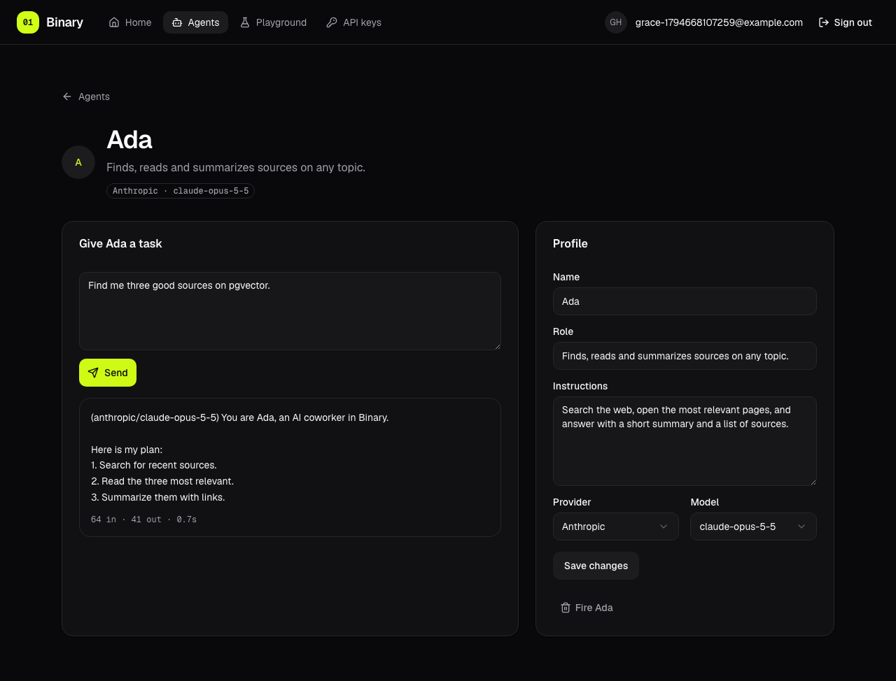

# Chapter 4: Agents

**Goal:** hire AI coworkers. Each agent has a name, a role, instructions and
the model it thinks with, and answers in character through the same
`EngineFactory` the playground uses. The proof: hire a Research Assistant
from a template, give it a task, and get an answer that knows who it is.



## What you get

- **Agents API** (`/api/agents`): list, hire, read, edit and fire agents,
  always limited to the signed-in user. Another user's agent is a plain 404.
- **Run an agent** (`POST /api/agents/:id/run`): the agent's profile becomes
  a system prompt, and its provider + model answer the message.
- **Templates** (`/api/agent-templates`): the four seeded starting points
  (Research Assistant, Coding Agent, Inbox Manager, Personal Assistant).
- **Agents page** (`/agents`): your agents, an empty state, and template cards.
- **Hire page** (`/agents/new`): a form pre-filled from a template, or blank.
  Providers without a key are shown but disabled.
- **Agent page** (`/agents/:id`): give the agent a task, edit its profile,
  or fire it.
- **Home:** shows your agents, and the next step is now key → agent →
  playground.

## Files in this chapter's docs

| File                                   | What's in it                                       |
| -------------------------------------- | -------------------------------------------------- |
| [IMPLEMENTATION.md](IMPLEMENTATION.md) | Plan, acceptance criteria, file-by-file, decisions |
| [ARCHITECTURE.md](ARCHITECTURE.md)     | Ownership, system prompt, API contracts            |
| [TESTING.md](TESTING.md)               | Tests and results                                  |
| [PR_REVIEW.md](PR_REVIEW.md)           | Review findings and fixes                          |
| [REBUILD_PROMPT.md](REBUILD_PROMPT.md) | Standalone prompt to rebuild this chapter          |
| [architecture/](architecture)          | Components, request flows, ownership and wiring    |
| [screenshots/](screenshots)            | Agents list, an agent's page (desktop + phone)     |

## Run it

No new settings and no migration: the `agents` table has existed since
Chapter 2.

```bash
pnpm db:seed   # makes sure the four templates exist
pnpm dev
```

Open http://localhost:3000 → **Agents**. If you have no API key yet, the page
sends you to **API keys** first.

## What comes next

Chapter 5 adds chat: real conversations with an agent, with history and
streamed answers, replacing today's one-message "Give a task" box.
