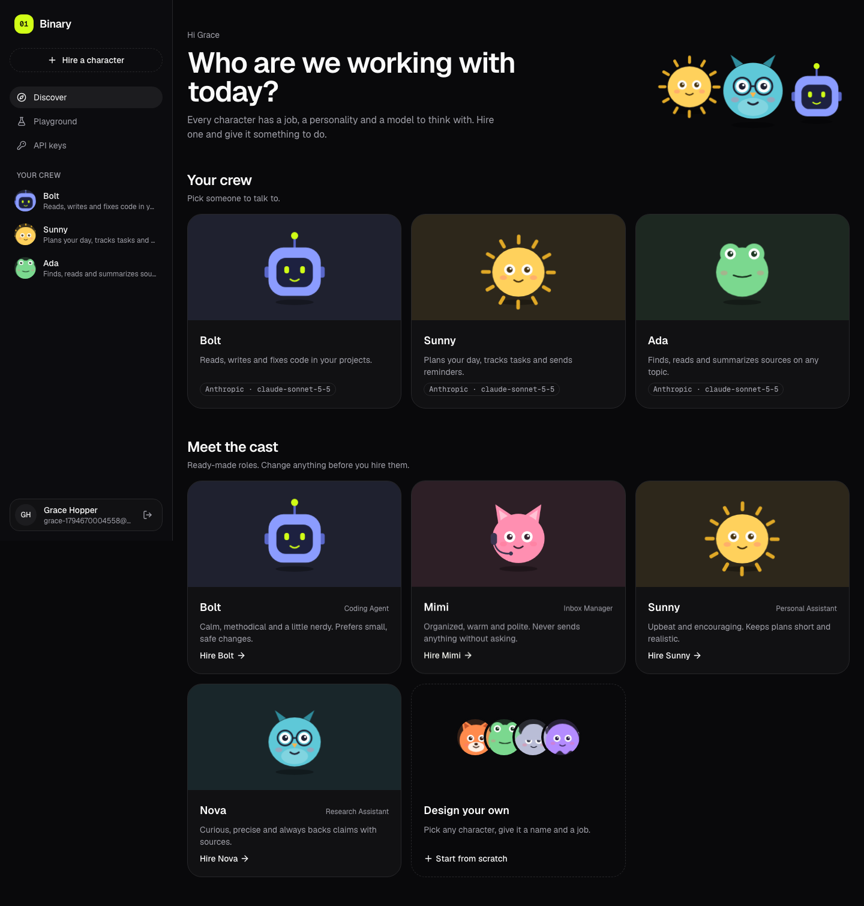
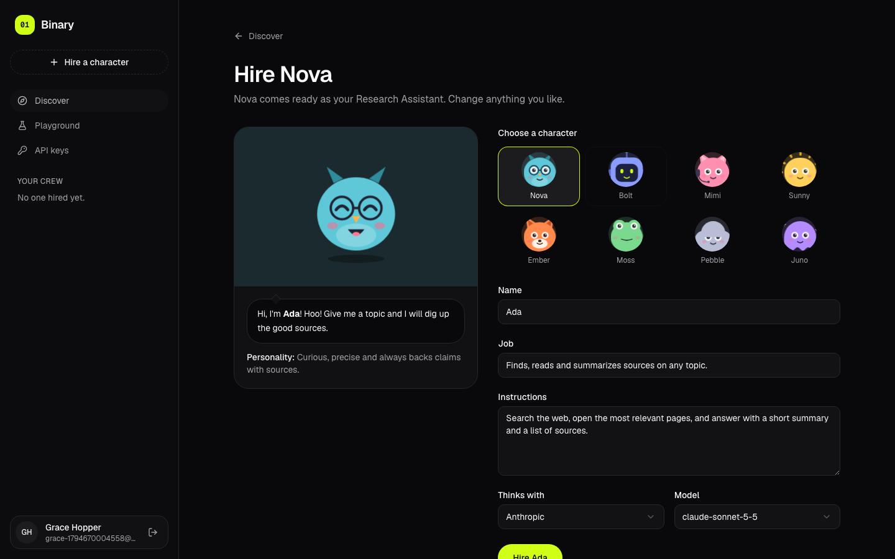

# Chapter 4: Agents as characters

Binary gets its coworkers. You hire **agents**, each played by a cartoon
character with a face, a personality and moods, and talk to them on a stage
that reacts to the conversation. Each agent has a job, instructions and a
model, and answers in character through the engine from chapter 3.



## What you'll learn

- How an agent's profile becomes a **system prompt**, rebuilt on every
  message so edits apply straight away
- **Ownership checks**: every query is scoped to the signed-in user, and a
  stranger's agent is a 404 so its id stays secret
- Why a response returns only the fields the app needs, never the whole row
- How **templates** are copied into a new agent, so editing one never
  changes the other
- How to draw and animate characters with **SVG and CSS**, and respect
  reduced motion

## Try it

No new settings and no migration.

```bash
pnpm db:seed   # makes sure the four templates exist
pnpm dev
```

Open http://localhost:3000. **Discover** shows the cast under "Meet the
cast". Pick Nova, rename her if you like, switch characters to watch the
preview change, and press the lime **Hire** button. Then give her a task.



## Good to know

- Without an API key, Pebble asks you to add one, and the hire page sends
  you to **API keys** first.
- Conversations aren't saved yet. **New chat** or a reload starts over.
  Saved chats arrive in chapter 5.
- The cast is eight characters. Four play the templates; the rest are free
  for agents you design yourself.

## Build it yourself

Paste [PROMPT.md](PROMPT.md) into your coding agent in your chapter 3 repo.
See [DIAGRAM.md](DIAGRAM.md) for how hiring and a reply flow through the API.

## Next

[Chapter 5](../chapter-05/README.md) saves every chat and streams the
answers word by word.
