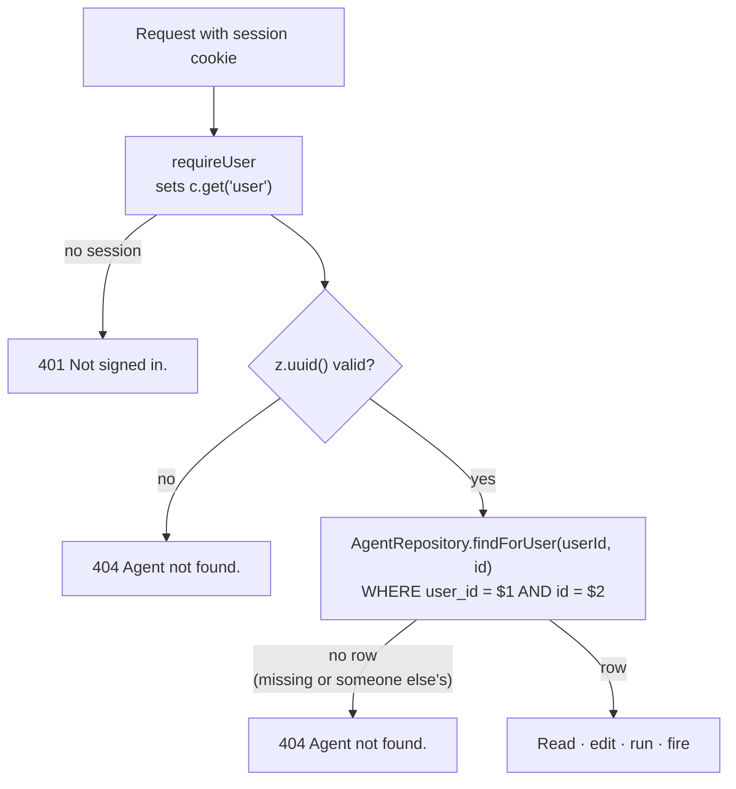
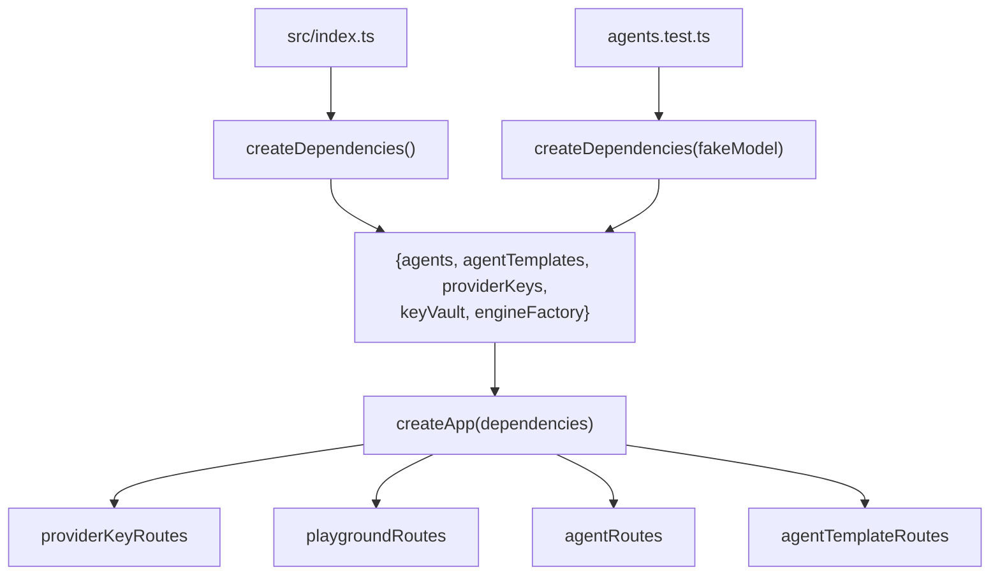
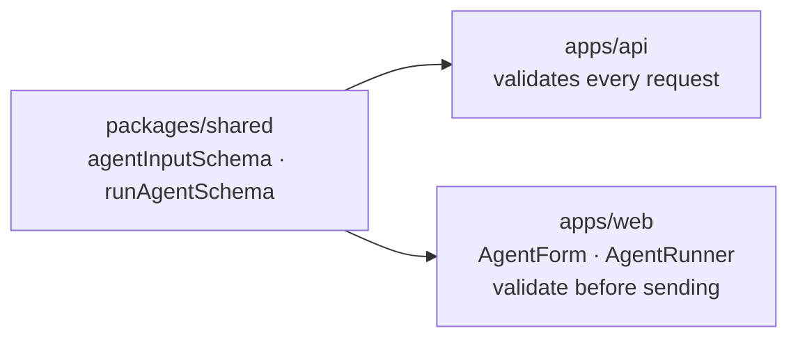

# Integration flow: ownership and wiring

## How ownership is enforced

The same `404` for "doesn't exist" and "not yours" means a user can't tell
whether someone else's id is real. Updates and deletes also filter by
`user_id`, so even a bug in a route can't touch another user's agent.

## Composition root

Two repositories joined the dependencies; nothing else in the wiring changed.

## Shared rules, one source

The web form and the API show the same messages ("Give your agent a name.")
because they run the same schema.
