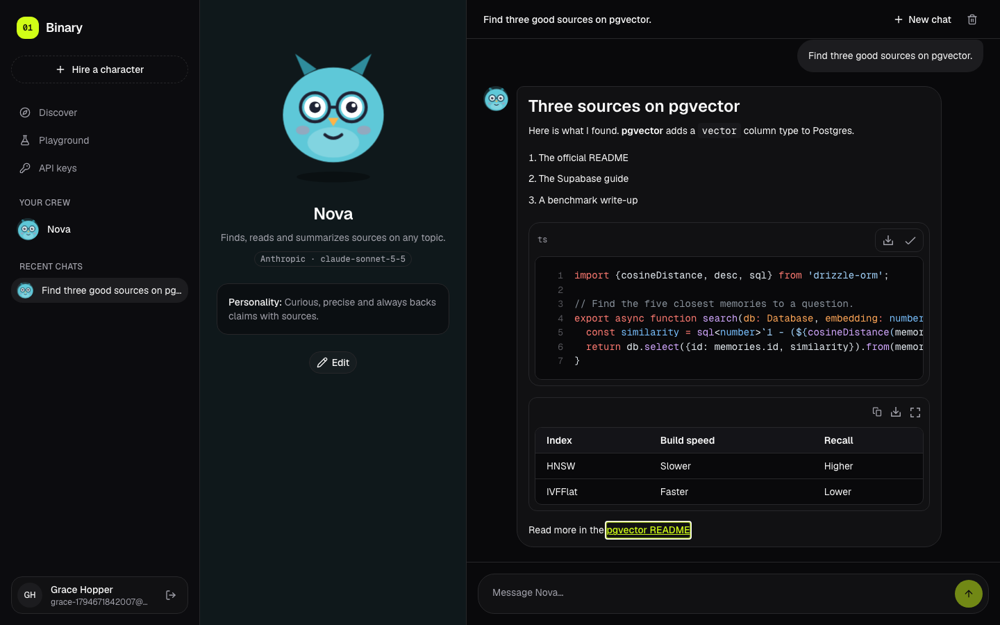
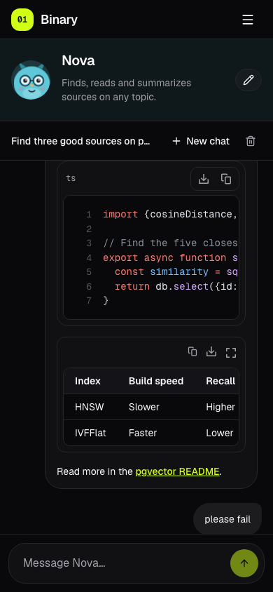
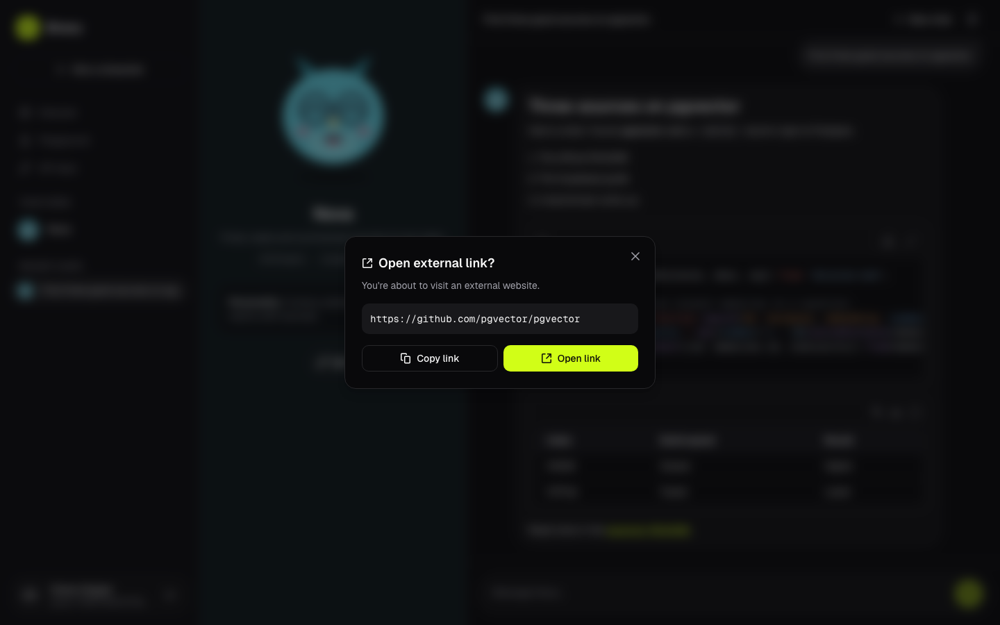

# Chapter 5, part 2: Markdown and code highlighting

**Goal:** answers look like a real assistant's: headings, lists, tables,
links and highlighted code, even while they are still streaming in.



## What changed

- **[Streamdown](https://streamdown.ai)** (`streamdown@2.7.1`) renders every
  answer in chat and the playground through one component,
  `components/chat/markdown.tsx`.
- **Code highlighting** with Shiki through `@streamdown/code@2.0.0`, theme
  `github-dark-default`. Code blocks show the language, line numbers, and
  copy and download buttons.
- **Streaming-safe:** Streamdown closes half-written Markdown while the
  answer arrives. An open code fence already renders as a code block, and
  `**`, `##` and back-ticks are never shown raw. A block caret (`▋`) follows
  the text while streaming.
- **Links ask first:** links in answers become buttons that open a
  confirmation before leaving Binary. Streamdown's link safety is on by
  default, and it fits: the model chose the link, not you.
- **Errors are separate from the answer:** a failure part-way keeps the
  words that arrived (rendered as Markdown), and the reason appears under
  them. Before, the reason was appended to the text, where it would now be
  parsed as Markdown.
- Your own messages stay plain text, as typed.

## Setup notes

Streamdown and its plugin style themselves with Tailwind classes, so
`globals.css` tells Tailwind to scan them:

```css
@source '../../node_modules/streamdown/dist/*.js';
@source '../../node_modules/@streamdown/code/dist/*.js';
```

Streamdown's README suggests the **root** `node_modules` for monorepos.
That's wrong for this repo: pnpm installs app dependencies in
`apps/web/node_modules`. The wrong path fails silently: everything renders,
but without styles.

`streamdown/styles.css` (the fade-in for streamed words) is imported in the
component. `[data-sd-animate]` joins the reduced-motion rule in
`globals.css`.

## Testing

No API changes, so the 98 unit tests are unchanged and pass. A browser run
with a fake model streaming a Markdown answer in 7-character chunks (a
heading, bold, inline code, a list, a TypeScript block, a table, a link)
passed 19/19:

- **During streaming:** across 30 samples, no raw ` ``` `, `**` or `##`
  appeared, and the code block rendered while its fence was still open.
- **The finished answer:**
  - Rendered a heading, bold text, inline code, a 3-item list and a 2-row
    table.
  - The code had at least 4 token colors and a `ts` label.
  - The caret disappeared, and the copy button put exactly the code on the
    clipboard.
  - The link opened the safety prompt without leaving the page.
- **After a reload:** the saved answer still renders as Markdown and is
  highlighted.
- **A failure part-way:** the partial answer stays as Markdown, with the
  reason underneath.
- **Phone (390px):** no sideways page scroll; long code lines scroll inside
  the block.
- **Playground:** answers use the same renderer.
- **Errors:** no unexpected console errors.

| Phone                                     | Link safety                                 |
| ----------------------------------------- | ------------------------------------------- |
|  |  |

**Known behaviour:** Shiki loads each language's grammar the first time it
appears, so a new language shows uncolored for a moment (under 1.5 s in the
test) before its colors arrive. Later blocks in that language are colored
straight away.

**Not verified:** real provider answers (no real keys were available).
