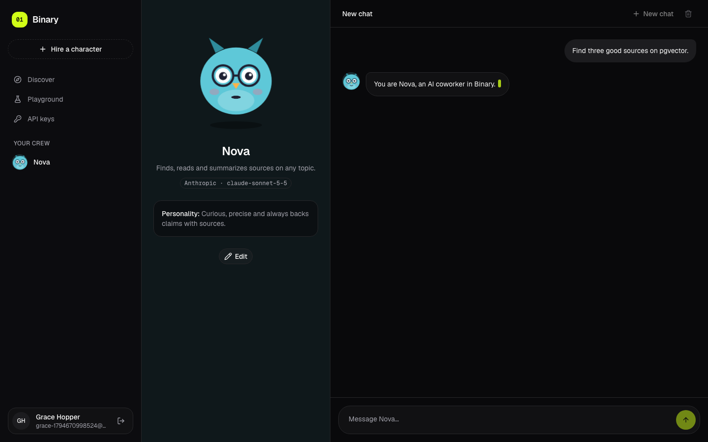

# Chapter 5: Chat

**Goal:** real conversations. Every chat with a character is saved, answers
stream in word by word, and your recent chats sit in the sidebar like any
chat app. The proof: ask Nova something, watch the answer type itself out
while Nova talks, reload the page, and the conversation is still there.



## What you get

- **Saved chats:** each conversation is a `thread` with its `messages`.
  Chapter 2 created those tables, so there's no migration. A new chat is
  saved on its first message.
- **Streaming:** `POST /api/threads/:id/messages` streams the answer as
  NDJSON (one JSON event per line): `delta` pieces, then `done` with the
  saved message, or `error`.
- **Memory within a chat:** the model reads up to the last 20 messages.
- **Automatic titles:** a chat is named after its first message, with no
  extra model call.
- **Recent chats** in the sidebar (and the phone drawer), most recent first,
  each with its character's face. Click one to pick up where you left off.
- **Chat header:** the title, **New chat** and **Delete chat**.
- **The character reacts to the stream itself:** thinking until the first
  word, talking while words arrive, happy when done, oops on errors. A lime
  caret shows where the answer is being written.
- **Failures are honest:** a provider error before or during the answer
  shows the reason. Words that already arrived stay visible. Your question
  is saved; the failed answer is not.

## Files in this chapter's docs

| File                                   | What's in it                                        |
| -------------------------------------- | --------------------------------------------------- |
| [IMPLEMENTATION.md](IMPLEMENTATION.md) | Plan, acceptance criteria, file-by-file, decisions  |
| [ARCHITECTURE.md](ARCHITECTURE.md)     | Streaming protocol, ownership, API contracts        |
| [TESTING.md](TESTING.md)               | Tests and results                                   |
| [PR_REVIEW.md](PR_REVIEW.md)           | Review findings and fixes                           |
| [REBUILD_PROMPT.md](REBUILD_PROMPT.md) | Standalone prompt to rebuild this chapter           |
| [architecture/](architecture)          | Components, request flows, the chat's state machine |
| [screenshots/](screenshots)            | Streaming, a saved chat, recent chats, phone        |

## Run it

No new settings, no migration.

```bash
pnpm dev
```

Open a character from **Your crew**, send a message, and watch it stream.
Reload to see it saved, or open it again from **Recent chats**.

## What comes next

Chats are one-on-one for now. The `rooms` table already exists for group
chats where several characters work together, and `tool_calls` and
`approval_requests` exist for tools that need your approval. Both arrive in
later chapters.
