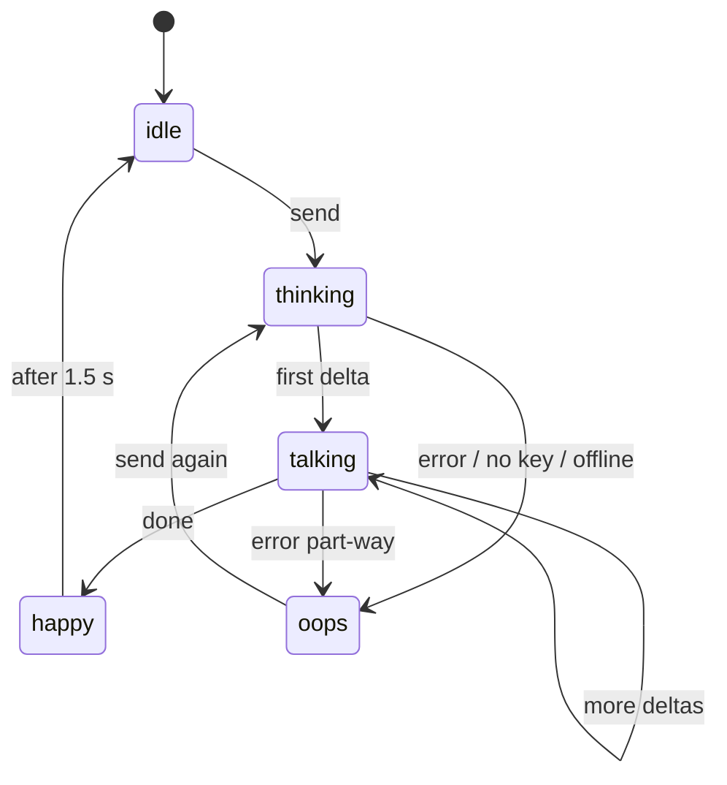
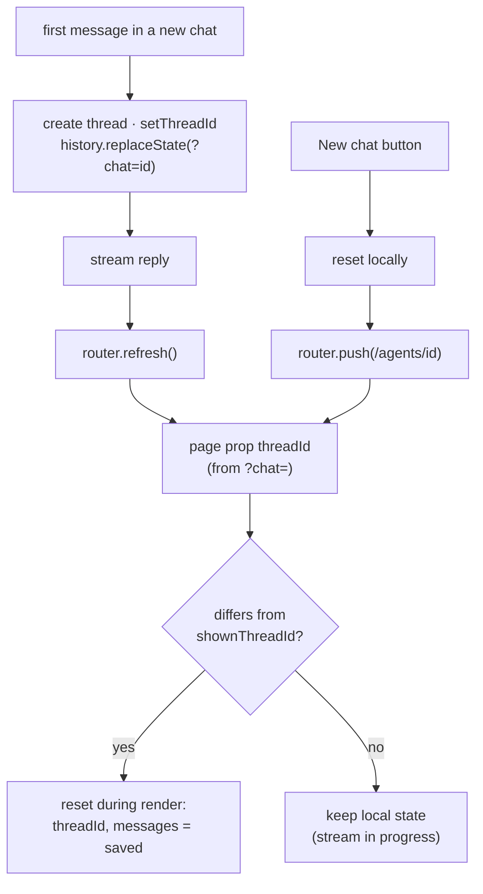

# Integration flow: what the chat screen is doing

## The character's moods follow the stream

## Which chat is on screen

Swapping the address with `replaceState` keeps this page mounted, so the
stream isn't cut off. The refresh afterwards brings the sidebar and the
title up to date. Switching chats from the sidebar changes `?chat=`,
which resets the screen to that chat's saved messages.
