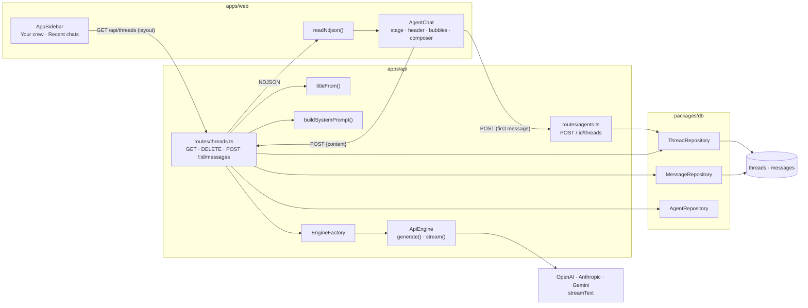
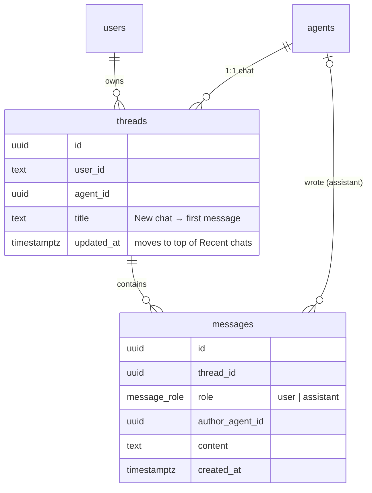

# System overview: Chapter 5

## Components

## Data used this chapter

`threads.room_id`, `messages.attachments`, `tool_calls` and
`approval_requests` exist from Chapter 2 and stay unused until group chats
and tools.
