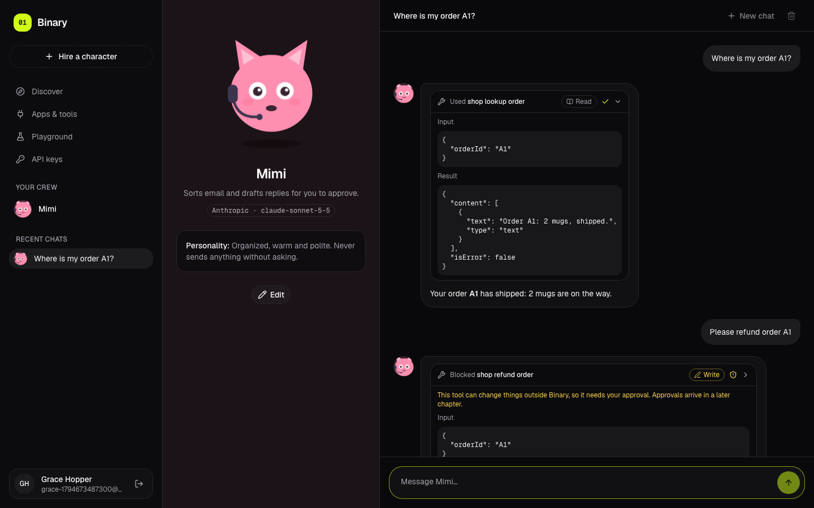

# Chapter 6: Tool system and MCP apps

**Goal:** agents stop only talking and start doing. Every tool has a risk
level (read, write or computer), apps plug in through MCP servers
(including Composio), and you can see every tool an agent used, inside its
reply. The proof: connect a shop app, ask Mimi where an order is, and watch
her look it up. Ask for a refund, and see it blocked.



## What you get

- **A tool registry with risk levels.**
  - **read:** only looks things up, so it runs straight away.
  - **write:** changes something outside Binary, so it's _blocked_ until
    Chapter 8 adds approvals.
  - **computer:** for sandboxes, browsers and your own computer (Chapters
    9–11).
- **Built-in tools:** `get_current_time`, and `fetch_web_page`, which only
  reaches public addresses (an SSRF guard).
- **Apps through MCP:** connect any Streamable-HTTP MCP server by URL, with
  an optional `Authorization` header that's stored encrypted. Composio URLs
  work the same way.
  - Binary connects before saving, so a wrong URL or token is caught on the
    form.
  - A tool is **read** only if its server marks it `readOnlyHint`; anything
    else counts as **write**.
- **Apps & tools page** (`/apps`): the risk levels explained, the built-in
  tools, your apps with their tools and risk, connect and remove.
- **Tools in chat:** each tool call appears inside the reply ("Using…",
  "Used…", "Blocked…") with its risk. Open it to see the exact input and
  result. Calls are saved with the answer, and the character _thinks_ while
  a tool runs.
- **Multi-step answers:** the model can call a tool, read the result and
  then answer, up to 5 steps per reply.
- **`AppError` hierarchy:** carried over from Chapter 4's scope. Routes
  throw `ValidationError`, `NotFoundError`, `MissingProviderKeyError`,
  `ProviderError` or `AppConnectionError`, and one `app.onError` turns them
  into JSON. A malformed JSON body is now a **400** instead of a 500.

## Files in this chapter's docs

| File                                   | What's in it                                        |
| -------------------------------------- | --------------------------------------------------- |
| [IMPLEMENTATION.md](IMPLEMENTATION.md) | Plan, acceptance criteria, file-by-file, decisions  |
| [ARCHITECTURE.md](ARCHITECTURE.md)     | Registry, policy, MCP, stream events, API contracts |
| [TESTING.md](TESTING.md)               | Tests and results                                   |
| [PR_REVIEW.md](PR_REVIEW.md)           | Review findings and fixes                           |
| [REBUILD_PROMPT.md](REBUILD_PROMPT.md) | Standalone prompt to rebuild this chapter           |
| [architecture/](architecture)          | Components, a tool call end to end, policy and risk |
| [screenshots/](screenshots)            | Apps page, tool calls in chat, phone                |

## Run it

No new settings, no migration.

```bash
pnpm dev
```

Open **Apps & tools**. Built-in tools work at once: ask any character
"What time is it in Tokyo?". To connect an app, create an MCP server URL
(for example in [Composio](https://composio.dev)), paste it, and add its
token in **Authorization header**, not in the URL.

## What comes next

Chapter 7 adds durable jobs and routines on Trigger.dev. Chapter 8 turns
"blocked" into "waiting for your approval".
