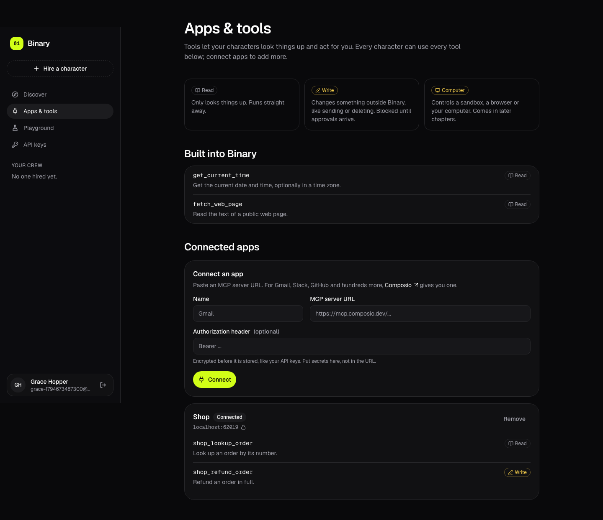

# Chapter 6: Tools and MCP apps

Characters stop only talking and start doing. They get built-in tools, plus
the tools of any app you connect through MCP (Composio included), and every
tool has a risk level: `read`, `write` or `computer`. In this chapter only
`read` tools run. Anything that could change the outside world is blocked
until Chapter 8 can ask you first.


## What you'll learn

- How **tool calling** works: the model asks for a tool, reads the result,
  then answers, over several steps
- What **MCP** (Model Context Protocol) is, and how one URL plugs a whole app
  into your agents
- Why every tool gets a **risk level**, and why "blocked" is the safe default
  until approvals exist
- How an **SSRF guard** stops a tool from reaching your private network
- How an **error hierarchy** (`AppError`) turns every failure into a clear
  JSON response

## Try it

No new settings and no migration.

```bash
pnpm dev
```

Ask any character "What time is it in Tokyo?" and open the tool call in the
reply to see its input and result. Then open **Apps & tools**, create an MCP
server URL (for example in [Composio](https://composio.dev)), paste it, and
put its token in **Authorization header**, not in the URL. Ask for something
the app can look up, then ask for something that changes it, and watch it get
blocked.



## Good to know

- Only MCP servers you reach by URL (Streamable HTTP) are supported, not
  local command-line ones. Composio gives you a URL.
- Every character gets every tool. Per-character control comes with
  approval modes in Chapter 8.
- Since Chapter 8, `write` and `computer` tools ask for your OK instead of
  being blocked.

## Build it yourself

Paste [PROMPT.md](PROMPT.md) into your coding agent in your chapter 5 repo.
See [DIAGRAM.md](DIAGRAM.md) for how a tool call flows.

## Next

[Chapter 7](../chapter-07/README.md) adds routines: jobs your characters run
on a schedule, by webhook or on demand, as durable Trigger.dev tasks.
