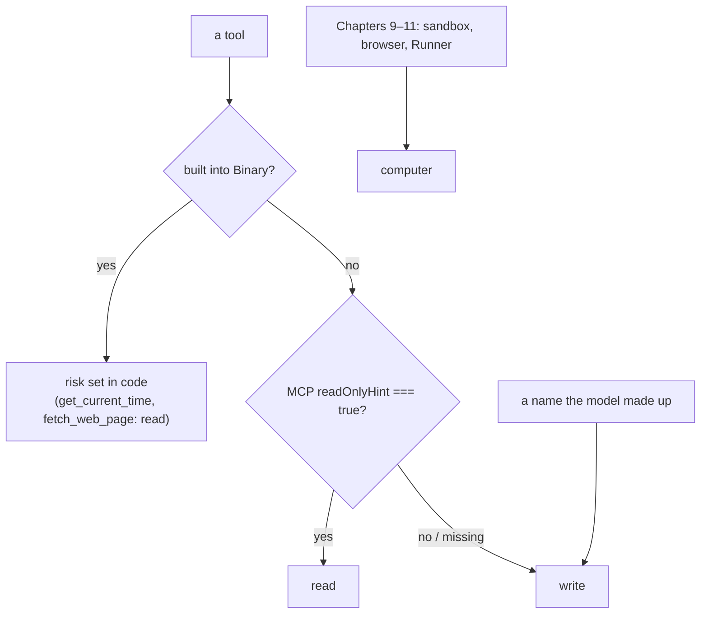
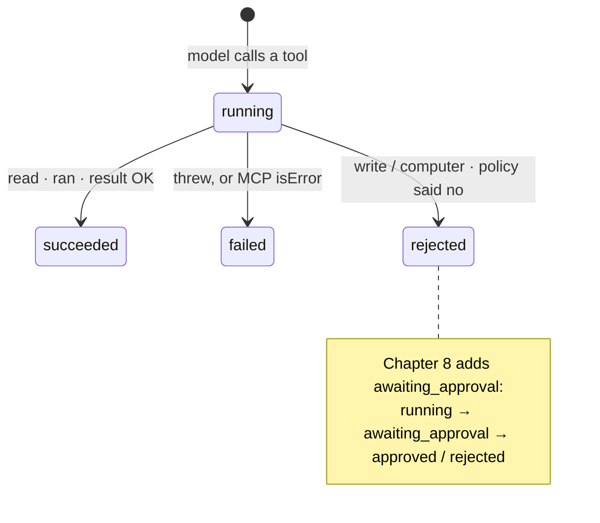
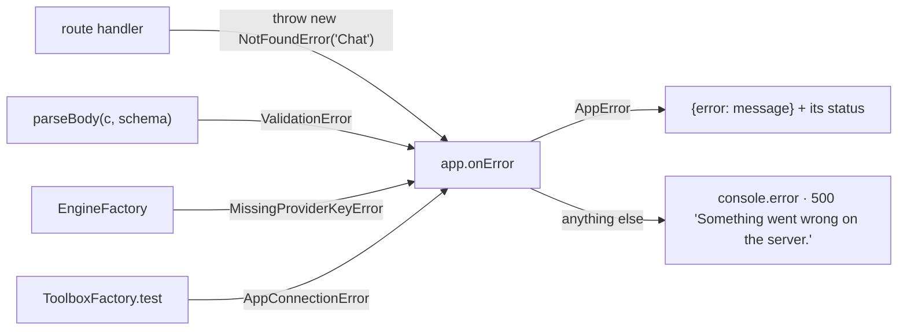

# Integration flow: risk, policy and errors

## Where a tool's risk comes from

## What the policy does with it

## How a route reports a problem

Once a chat answer is streaming, the status is already 200. A provider
failure then becomes an NDJSON `error` event instead (Chapter 5).
