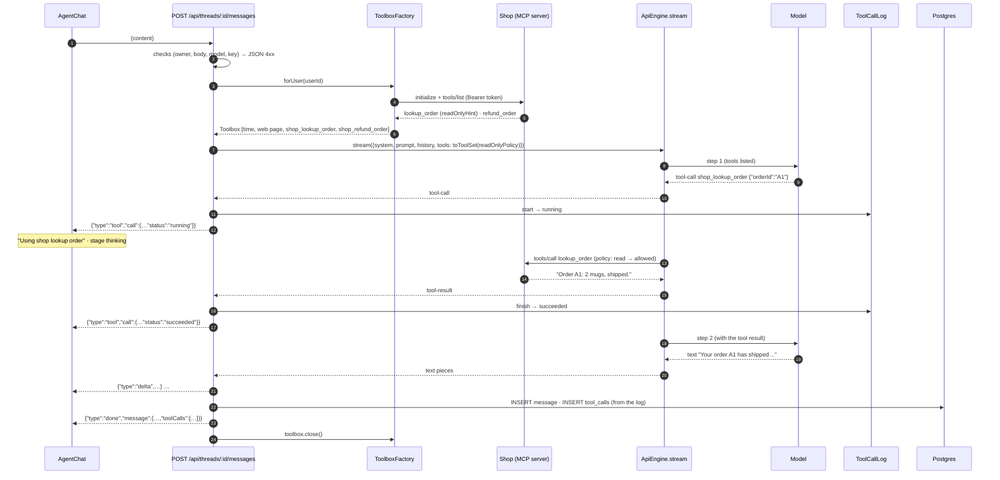
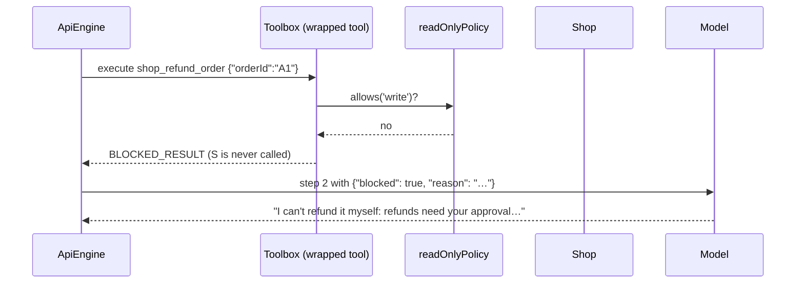

# Request flow: a tool call, end to end

"Where is my order A1?", asked to Mimi, with the Shop app connected.

## When the tool writes

"Please refund order A1" follows the same steps until the tool call. Then:

The call is saved as `rejected`, and the reply shows "Blocked shop refund
order · Write".
