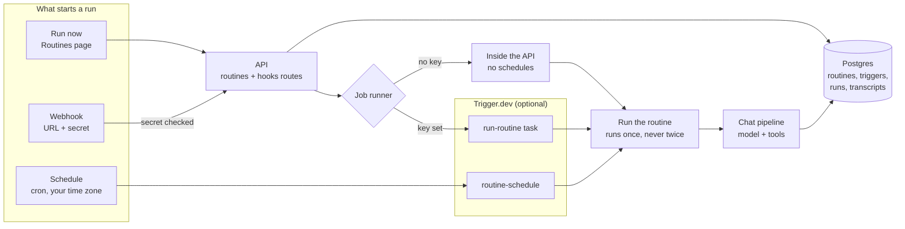

# Chapter 7 diagram

Three things can start a run, and one job runner decides where it happens:
on Trigger.dev when it's set up, inside the API when it isn't. Either way the
run goes through the same chat pipeline and leaves a transcript.

