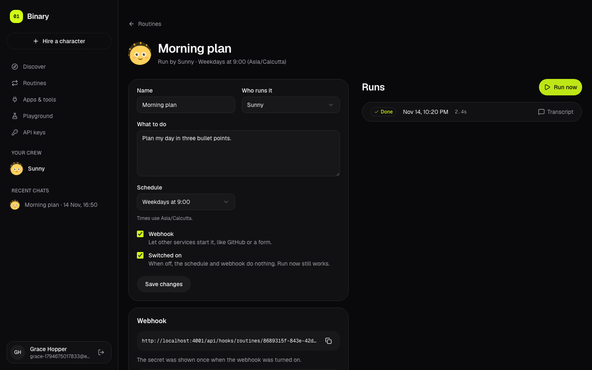
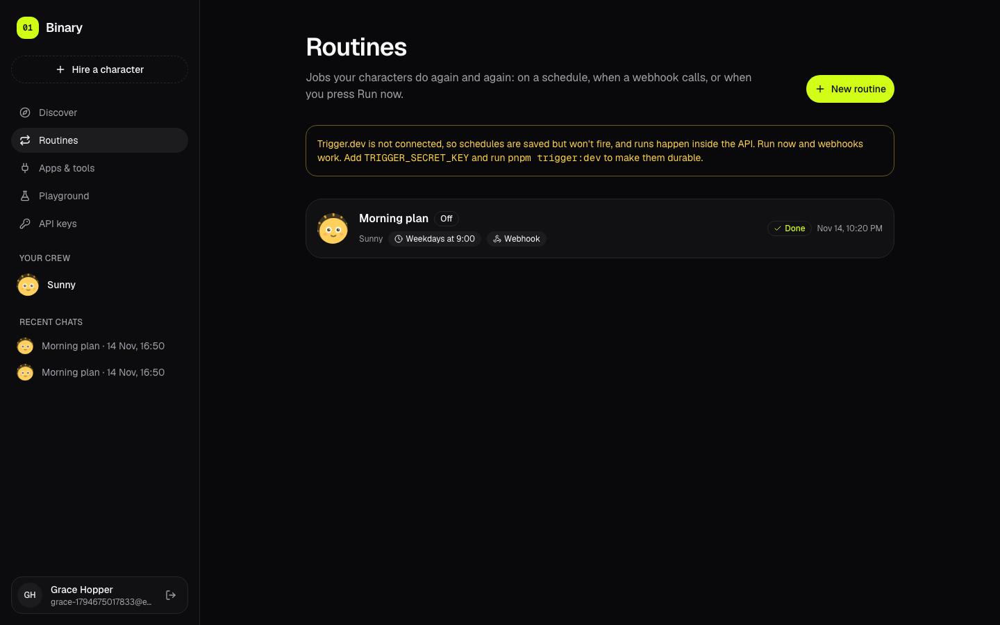

# Chapter 7: Routines and durable jobs

Characters now work when you're not watching. A routine is a job a character
does again and again, like "every weekday at 9:00, plan my day". It runs on a
schedule, when a webhook calls, or when you press **Run now**, and every run
leaves a transcript you can open like any chat.



## What you'll learn

- What a **durable job** is, and why long work belongs in a job runner
  instead of an HTTP request
- How **Trigger.dev** runs tasks and fires cron schedules in your time zone
- The **Strategy pattern** again: one job runner interface, with Trigger.dev
  or an in-API fallback behind it
- How a **webhook secret** is shown once and stored only as a hash
- Why a webhook's body is treated as data, not instructions (**prompt
  injection**)

## Try it

One small migration adds a time zone to schedules:

```bash
pnpm db:migrate
pnpm dev
```

Open **Routines**, create one, and press **Run now**. Watch it go from
Queued to Done, then open its **Transcript**. That works without any extra
setup. For schedules that actually fire, connect Trigger.dev (the full steps
are in the [setup guide](../../SETUP.md#routines-on-triggerdev)):

```bash
# project ref in apps/api/trigger.config.ts, TRIGGER_SECRET_KEY in .env
pnpm --filter @binary/api exec trigger login   # once
pnpm trigger:dev                               # in a second terminal
```



## Good to know

- **Without `TRIGGER_SECRET_KEY`**, routines run inside the API and
  schedules don't fire. Those runs aren't durable: restarting the API
  mid-run leaves it "Running".
- **With `TRIGGER_SECRET_KEY` set**, every run goes through Trigger.dev, so
  keep `pnpm trigger:dev` running, or runs stay "Queued". In development,
  schedules only fire while it runs.
- The Trigger.dev packages must all be on the same version.
- Routines use the same tools as chat, so `write` tools are still blocked
  here until Chapter 8.

## Build it yourself

Paste [PROMPT.md](PROMPT.md) into your coding agent in your chapter 6 repo.
See [DIAGRAM.md](DIAGRAM.md) for what starts a run and where it goes.

## Next

[Chapter 8](../chapter-08/README.md) adds approvals: risky tools ask for
your OK instead of being blocked, and a Today inbox collects what's waiting.
