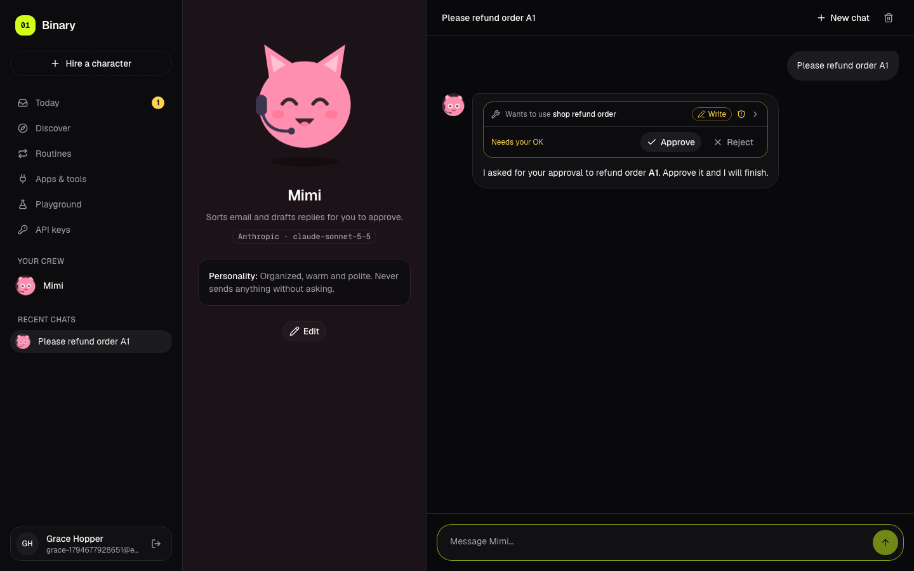
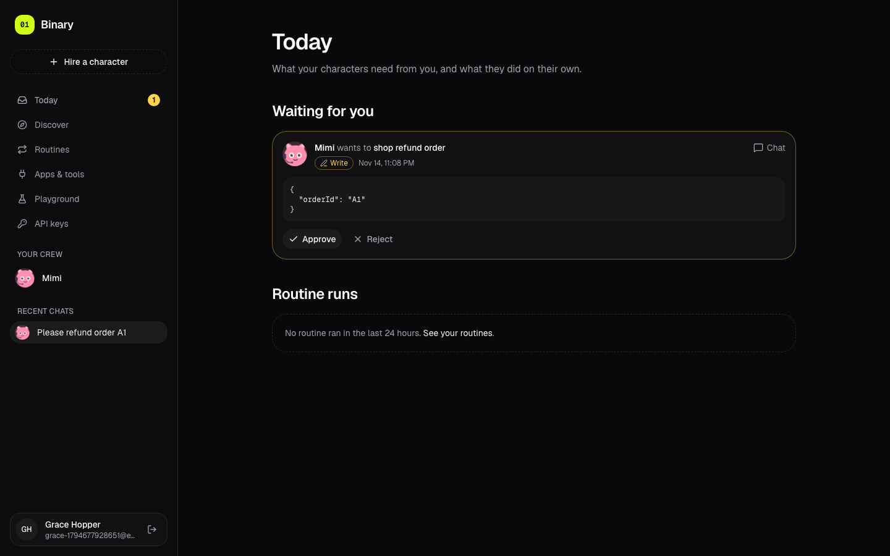
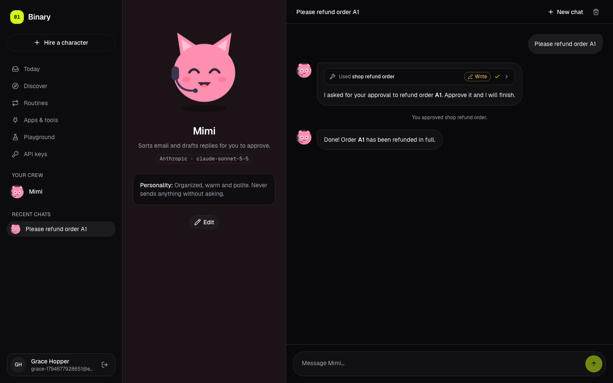

# Chapter 8: Approvals and the Today inbox

Characters can now do real things, and you stay in charge. Each character
has an approval mode. When a tool needs your OK, the character asks, the
request waits in the chat and in **Today**, and approving runs the tool. Then
the character carries on in the same chat.



## What you'll learn

- **Human-in-the-loop** approvals: the agent proposes, you decide
- How one **policy table** turns an approval mode and a risk level into
  run, ask or block
- Why asking **never blocks anything**: a request is a row in the database,
  not a waiting process, so it survives restarts
- How one conditional database update makes a decision happen **exactly
  once**, even with two clicks on two devices
- How the agent **follows up** after your decision as a normal new turn

| Approval mode          | `read` | `write` | `computer` |
| ---------------------- | ------ | ------- | ---------- |
| Plan only              | never  | never   | never      |
| Ask first              | ask    | ask     | ask        |
| **Auto-approve reads** | run    | ask     | ask        |
| Accept edits           | run    | run     | ask        |

## Try it

No new settings and no migration.

```bash
pnpm dev
```

Connect an app with a write tool (Chapter 6) and ask a character to use it.
Approve it in the chat, or open **Today**, first in the sidebar, and approve
it there. You'll see "You approved …" in the chat, then the character's
reply.





## Good to know

- **Characters hired before this chapter** keep the database default, Ask
  first, so they now ask even before reading. Switch them to Auto-approve
  reads under **Edit → Permissions**. New characters start there.
- Requests don't expire yet. Old ones wait until you decide.
- The Today count updates when a page loads. A request from a routine shows
  up on the next load, not instantly.
- Approving waits for the tool and the character's reply, so a slow tool
  makes the button slow.

## Build it yourself

Paste [PROMPT.md](PROMPT.md) into your coding agent in your chapter 7 repo.
See [DIAGRAM.md](DIAGRAM.md) for a request from asking to approving.

## Next

[Chapter 9](../chapter-09/README.md) adds cloud sandboxes with E2B: the
first `computer` tools, which ask first in every mode except Plan only.
