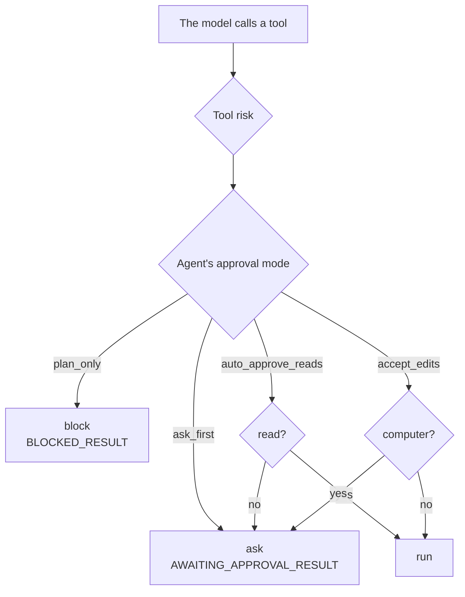
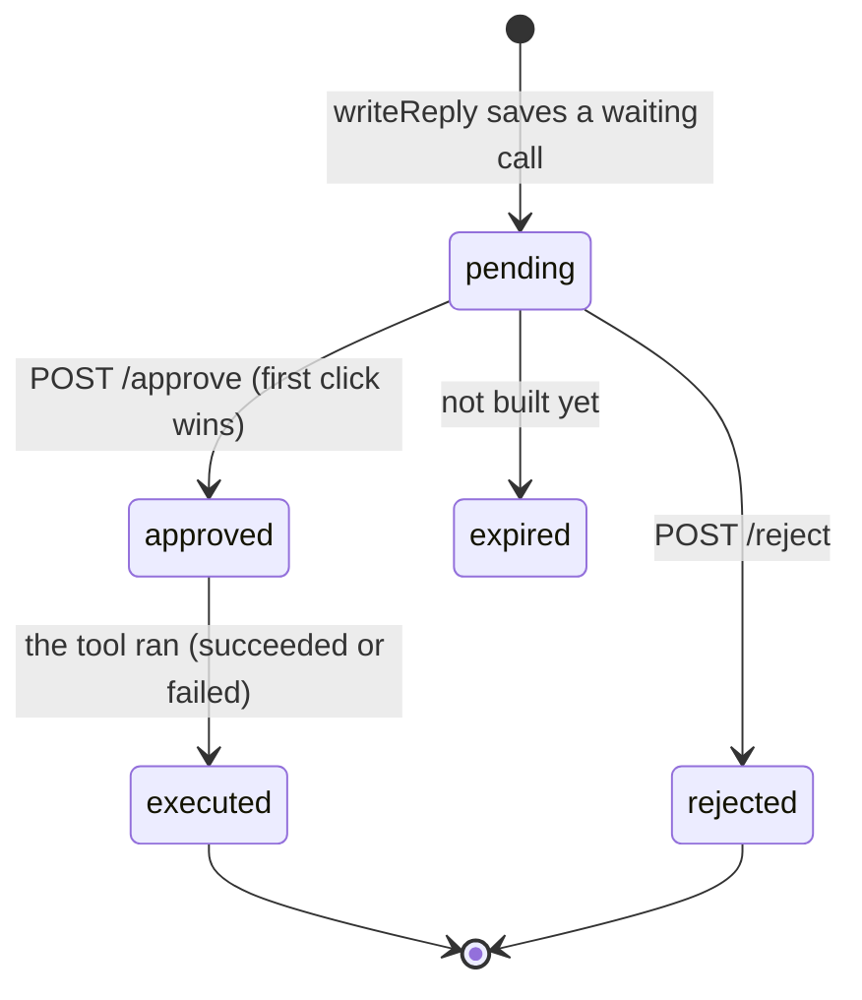
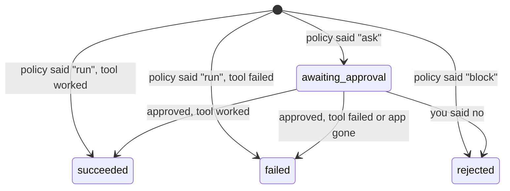

# Policy and states

## What the policy decides

## An approval request

## Its tool call

The UI tells "blocked" and "you said no" apart by the saved output
(`{blocked: true}` vs `{rejected: true}`), because both use the `rejected`
status.
