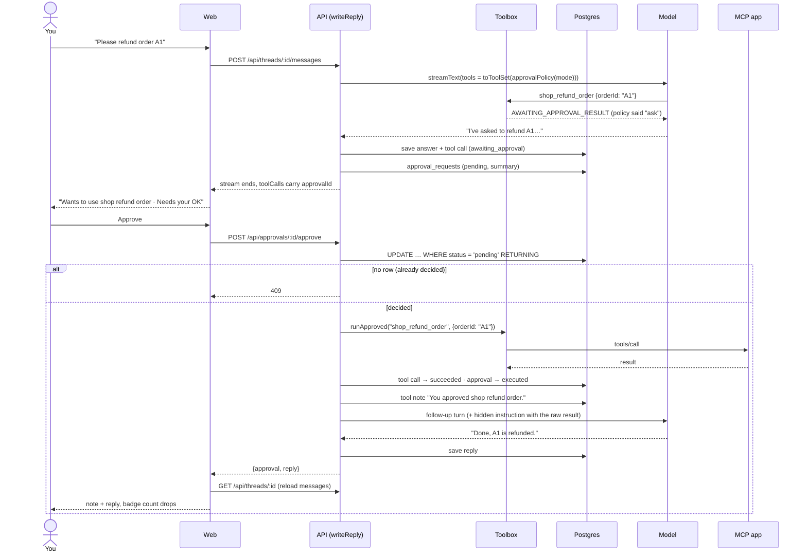

# Request flow: asking, then approving

Rejecting follows the same path without `runApproved`: the tool call is
saved as `rejected`, the note says "You rejected …", and the agent is told
not to try again unless asked.
