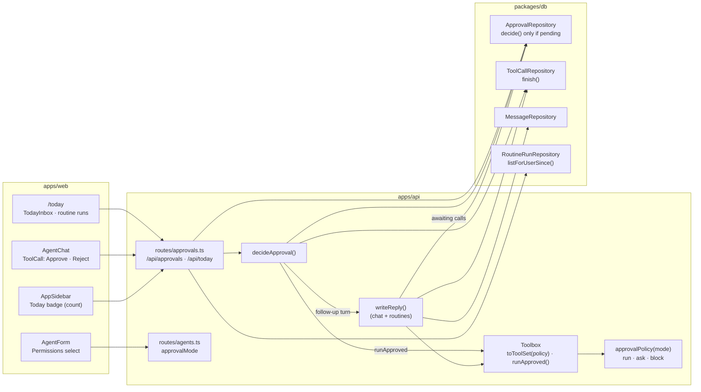

# System overview: Chapter 8

## Components

## What is new

| Piece                            | Role                                                                        |
| -------------------------------- | --------------------------------------------------------------------------- |
| `approvalPolicy(mode)`           | The Chapter 6 Strategy, now with three answers instead of two               |
| `ApprovalRepository`             | Requests as rows; one conditional update decides each one, once             |
| `decideApproval()`               | Records the decision, runs or rejects the tool, and has the agent follow up |
| `/api/approvals`, `/api/today`   | The inbox, decisions and the sidebar count                                  |
| `TodayInbox`, `ToolCall` buttons | The two places you decide                                                   |
