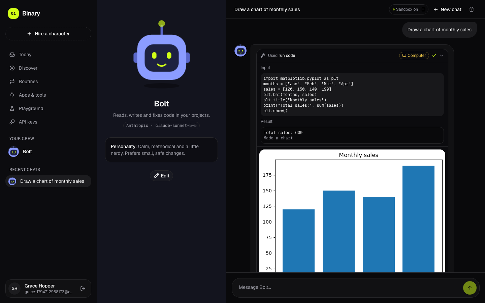
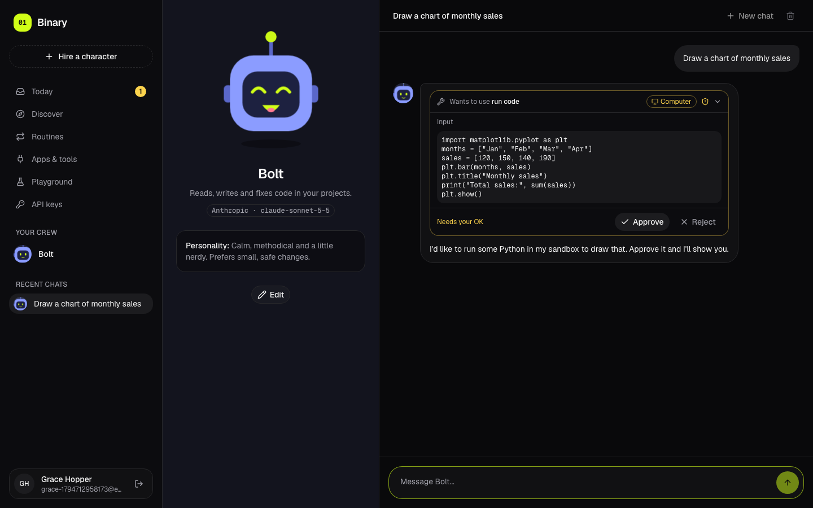

# Chapter 9: Cloud sandboxes with E2B

Characters can now run real code. A character whose computer is a **cloud
sandbox** gets a private Linux machine from E2B for each chat, where it runs
Python or JavaScript, runs commands and works with files. Charts it draws
show up right in the chat.



## What you'll learn

- How a **cloud sandbox** lets an agent run untrusted code away from your
  machine
- Why running code is a **computer** tool that always asks first, while
  reading files doesn't
- How to manage a resource's **lifecycle**: start on first use, reuse it,
  stop it when idle or when the chat is deleted
- Why the user and the model see **different views** of a result (the chart
  for you, a short note for the model)
- How a small **provider interface** lets tests use a fake sandbox instead
  of E2B

## Try it

1. Get an API key at [e2b.dev/dashboard](https://e2b.dev/dashboard). The
   free tier is enough.
2. Add it to `.env` and restart:

   ```bash
   E2B_API_KEY=e2b_...
   pnpm dev
   ```

3. Hire the **Coding Agent**, or set **Edit → Computer → Cloud sandbox** on
   any character, and ask: _"Plot the squares of 1 to 10."_

The character asks to run its code, and you see the exact code before you
click **Approve**. The chat header then shows **Sandbox on** with a Stop
button, and **Apps & tools** lists every running sandbox.



## Good to know

- **Without `E2B_API_KEY`, there's no sandbox.** Nothing breaks: the form
  and the Apps page just say how to turn it on.
- A sandbox stops after 10 idle minutes (and E2B's free plan ends one after
  an hour). The next run starts a fresh one, so earlier files are gone.
- The repo pins the `e2b` package to a release that had been out a while,
  because `@e2b/code-interpreter` pulled in one only a day old. Keep that
  pin if your install picks up a brand-new version.
- No migration: the tables for computers were already there from chapter 2.

## Build it yourself

Paste [PROMPT.md](PROMPT.md) into your coding agent in your chapter 8 repo.
See [DIAGRAM.md](DIAGRAM.md) for what happens when a character runs code.

## Next

[Chapter 10](../chapter-10/README.md) gives characters a second kind of
computer: a headless browser with Playwright.
