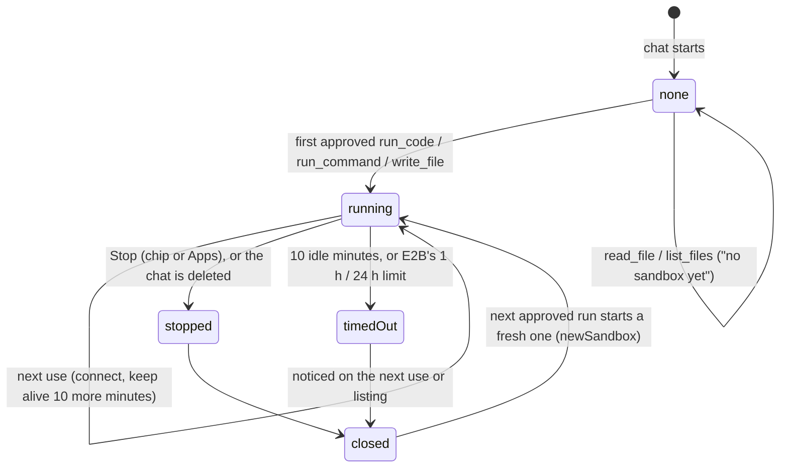
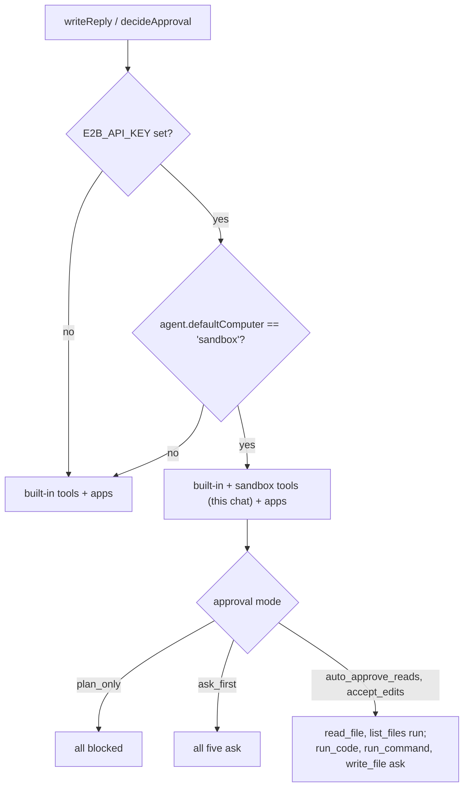

# Sandbox states

## A chat's sandbox

`computer_sessions.status` only has `running` and `closed`. A sandbox that
timed out on E2B's side stays `running` in the database until the next
use, or until someone lists sandboxes. Then the provider says it's gone and
the row is closed. `minutesUsed` keeps the value from its last use, rather
than counting idle time it may not have run.

## Which tools an agent gets

