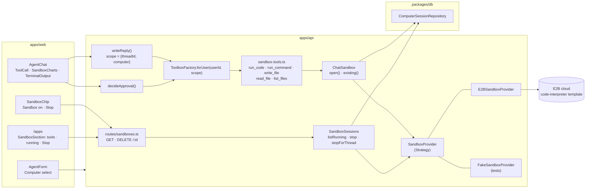

# System overview: Chapter 9

## Components

## What is new

| Piece                                                 | Role                                                          |
| ----------------------------------------------------- | ------------------------------------------------------------- |
| `SandboxProvider` / `CloudSandbox`                    | The Strategy that hides E2B; a fake for tests                 |
| `ChatSandbox`                                         | One chat's sandbox: started on first use, found again later   |
| `SandboxSessions`                                     | Every running sandbox: list (closing timed-out ones) and stop |
| `sandboxTools()`                                      | Five tools bound to one chat's sandbox                        |
| `ComputerSessionRepository`                           | `computer_sessions` rows: create, find, touch, close          |
| `AgentTool.forModel`                                  | What the model reads instead of the full result               |
| `SandboxChip`, `SandboxSection`, `sandbox-output.tsx` | Where you see and stop sandboxes, and read their output       |
