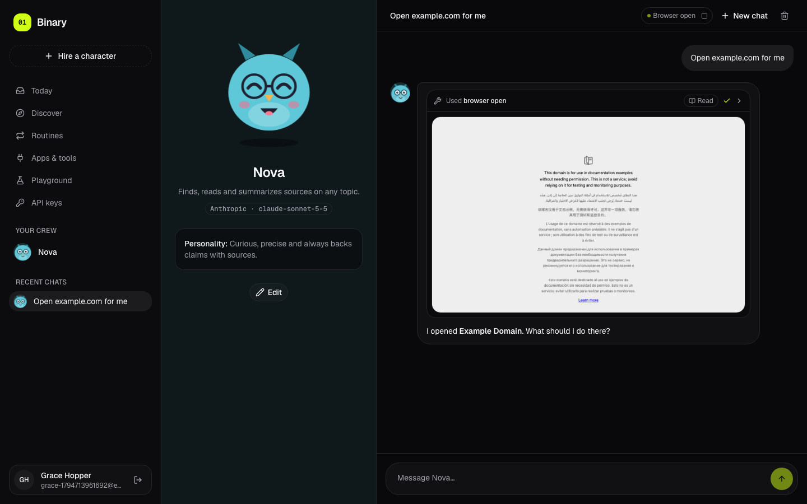
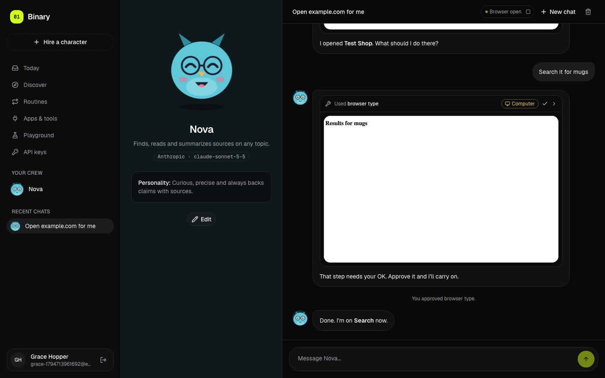
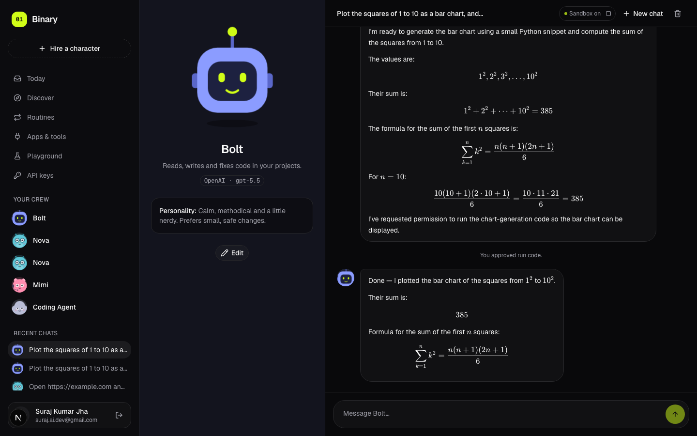

# Chapter 10: Browser automation with Playwright

**Goal:** characters can use the web like a person does. A character whose
**Computer** is a **browser** gets a headless Chromium for each chat. It
opens pages, reads them, and, after you approve, clicks and types. You see
a screenshot of every step.



## What you get

- **A second computer** on the hire and edit form: **Computer** → None,
  Cloud sandbox or **Browser**. The Research Assistant template starts with
  a browser.
- **Four browser tools:**

  | Tool            | What it does                                                    | Risk     |
  | --------------- | --------------------------------------------------------------- | -------- |
  | `browser_open`  | Open a public page; returns its text, elements and a screenshot | Read     |
  | `browser_read`  | Read the current page again, with fresh refs                    | Read     |
  | `browser_click` | Click a link, button or checkbox by its ref                     | Computer |
  | `browser_type`  | Type into a field by its ref; optionally press Enter            | Computer |

- **Looking is free; acting asks.** Opening and reading a page is like
  Chapter 6's `fetch_web_page`, so it runs straight away. Clicking and
  typing can submit forms, buy, send or delete, so they ask first in every
  permission mode.
- **Refs instead of guesswork.** Every result lists the page's links,
  buttons and fields as numbered **elements**, and the agent clicks
  "ref 3", not a CSS selector it made up. Refs are handed out again each
  time the page is read, and a stale ref fails at once with a clear
  message.
- **Screenshots for you, text for the model.** Each step's screenshot
  appears under its tool row. The model reads the page's text and
  elements, plus a note that you can see the picture.
- **Public web only.** Every request the browser makes is checked first
  against the same rule as `fetch_web_page`: navigations, redirects, form
  posts, images and new tabs. A page can't steer the browser to your
  router, a database or this API.
- **One browser per chat, and nothing runs unseen.**
  - The browser opens on first use and keeps its tabs and cookies for the
    chat.
  - The chat header shows **Browser open** with a Close button.
  - **Apps & tools** lists every open browser.
  - Deleting a chat closes its browser, as do 10 idle minutes.
  - At most 5 browsers are open at once.
- **Sandboxes and browsers share one API:** `/api/computers` lists and
  stops both.



Tried with real models: Claude Sonnet 5.5 browsing example.com and
following its link after approval, and GPT-5.5 drawing a chart in a real
E2B sandbox. That run also brought **math rendering** to the chat (LaTeX
shows as formulas) and fixed text that ran together around tool calls.



## Files in this chapter's docs

| File                                   | What's in it                                           |
| -------------------------------------- | ------------------------------------------------------ |
| [IMPLEMENTATION.md](IMPLEMENTATION.md) | Plan, acceptance criteria, file-by-file, decisions     |
| [ARCHITECTURE.md](ARCHITECTURE.md)     | The browser, refs, the guard, the computers API        |
| [TESTING.md](TESTING.md)               | Tests and results                                      |
| [PR_REVIEW.md](PR_REVIEW.md)           | Review findings and fixes                              |
| [REBUILD_PROMPT.md](REBUILD_PROMPT.md) | Standalone prompt to rebuild this chapter              |
| [architecture/](architecture)          | Components, a click end to end, the guard and states   |
| [screenshots/](screenshots)            | Opening a page, asking to click, a search, Apps, phone |

## Run it

Chromium is downloaded once (about 100 MB). `pnpm setup` now does it, and
on an existing checkout you run:

```bash
pnpm browsers:install
pnpm dev
```

Then hire the **Research Assistant** (or set **Edit → Computer → Browser**)
and ask: _"Open example.com and tell me what it says."_

Without Chromium, nothing changes: characters simply have no browser, and
the form and the Apps page say how to turn it on. No migration and no new
setting.

## What comes next

Chapter 11 adds the third kind of computer: **your own**, through a local
Runner, plus Claude Code and Codex as engines and E2B Desktop.
