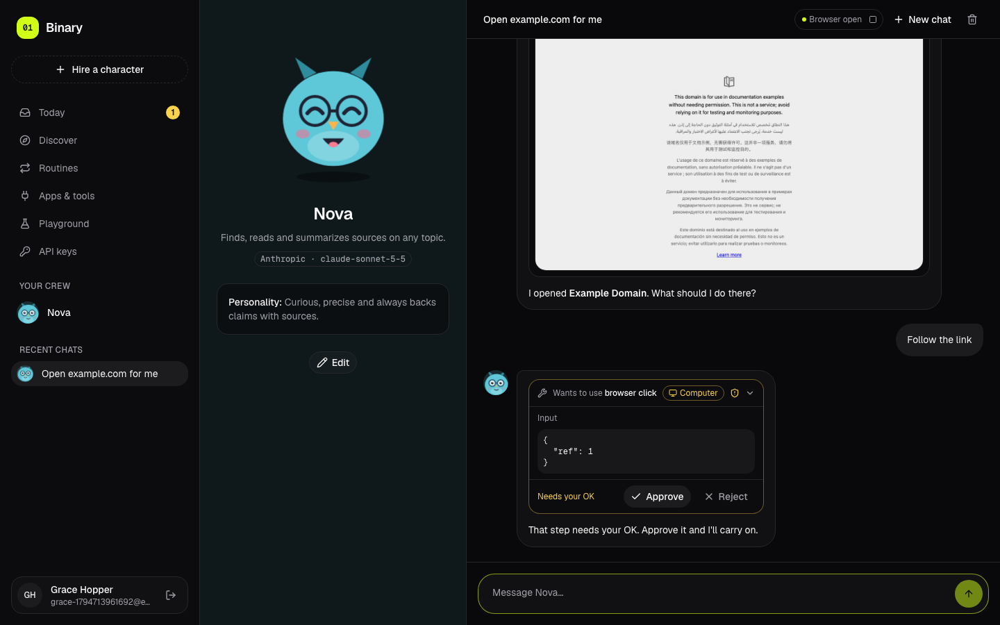

# Chapter 10: Browser automation with Playwright

Characters can now use the web like a person. A character whose computer is
a **browser** gets a headless Chromium for each chat: it opens and reads
pages on its own, and clicks and types after you approve. You see a
screenshot of every step.


## What you'll learn

- How **Playwright** drives a real browser from code, with one isolated
  context per chat
- Why looking is a **read** and clicking or typing is a **computer** action
  that asks first
- How to stop **server-side request forgery**: a browser on your server
  must only reach public addresses
- Why the model works with **numbered elements** ("click ref 3") instead of
  guessing CSS selectors
- How one **computers** API can list and stop different kinds of computers

## Try it

Chromium is downloaded once (about 100 MB). `pnpm setup` does it now; on a
checkout you already set up, run:

```bash
pnpm browsers:install
pnpm dev
```

Hire the **Research Assistant**, or set **Edit → Computer → Browser** on any
character, and ask: _"Open example.com and tell me what it says."_ Then ask
it to follow the link. That's a click, so it waits for your OK.



The chat header shows **Browser open** with a Close button, and **Apps &
tools** lists every open browser and running sandbox.

## Good to know

- **Without Chromium, there's no browser.** The form and the Apps page say
  how to install it. No migration and no new setting.
- Browsers live in the API's memory, so restarting the API closes them. At
  most 5 are open at once, and each closes after 10 idle minutes.
- Every new browser starts signed out. There are no saved logins yet.
- Chats now render math, because real models like to answer with LaTeX.

## Build it yourself

Paste [PROMPT.md](PROMPT.md) into your coding agent in your chapter 9 repo.
See [DIAGRAM.md](DIAGRAM.md) for how a browser step flows and where the
address check sits.

## Next

[Chapter 11](../chapter-11/README.md) adds the third kind of computer, your
own, through a local Runner, plus Claude Code, Codex and a cloud desktop.
