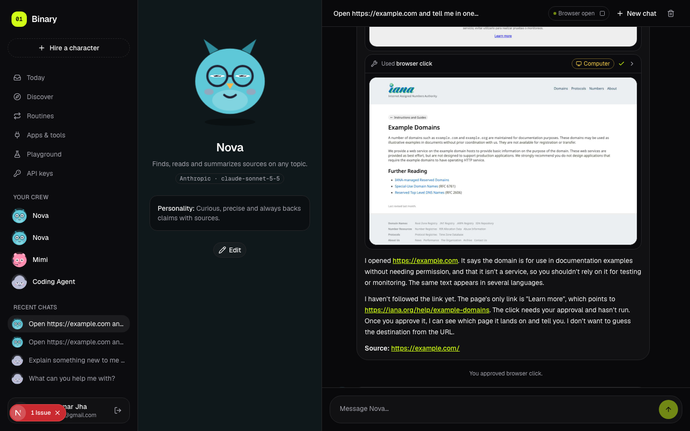

# Chapter 10: Testing

```bash
pnpm browsers:install   # once
pnpm test
```

The browser tests drive **real Chromium**. `src/test-web-site.ts` serves a
tiny shop on 127.0.0.1. Its home page has, in order:

| Ref | Element                          |
| --- | -------------------------------- |
| 1   | a Pricing link                   |
| 2   | a search box                     |
| 3   | a Search button                  |
| 4   | a Docs link that opens a new tab |

It also has `/alert`, `/leak` (a link and an image pointing at a second,
"private" server) and `/secret`. Tests pass a guard that lets the browser
reach the shop. The guard tests either refuse the second server's port or
use the real `publicUrlsOnly`, which refuses loopback.

## New and changed suites

| Suite             | File                                         | Tests                                                                         |
| ----------------- | -------------------------------------------- | ----------------------------------------------------------------------------- |
| Agent schema      | `packages/shared/src/agents.test.ts`         | `browser` accepted; `runner` still refused (more checks in the existing test) |
| ChatBrowser       | `apps/api/src/browsers/chat-browser.test.ts` | 8, listed below                                                               |
| Browsers via chat | `apps/api/src/routes/browsers.test.ts`       | 10, listed below                                                              |
| Sandboxes         | `apps/api/src/routes/sandboxes.test.ts`      | Moved to `/api/computers` and `{computers}` on Apps; same 15 checks           |
| Routines          | `apps/api/src/routes/routines.test.ts`       | The new `createDependencies` options                                          |

The `ChatBrowser` tests cover:

- opening a page: title, the four elements with refs, kinds and hrefs,
  the text, and a JPEG screenshot (`read` has none)
- clicking ref 1, and typing and submitting a search
- following a link that opens a new tab
- an unknown ref failing fast with its message
- an alert not stopping the page
- a private address refused
- a link from a public page to a private one blocked, without the
  private text showing
- the real guard refusing loopback

The tests through chat cover:

- the four tools on Apps with their risks
- `available` being `{sandbox: false, browser: true}`
- the tools offered only to browser agents
- opening runs without asking, saves the screenshot, and keeps the image
  out of the model's prompt (it gets the page text and the note)
- the browser listed with its chat
- clicking asks, and after approval clicks in the same browser
- typing asks, then searches
- another user gets 404
- Close works, and the next read gets "no browser open"
- reading in a chat with no browser opens none
- deleting a chat closes its browser
- the real guard refuses the local site

## Results

| Check                              | Result                                                                                  |
| ---------------------------------- | --------------------------------------------------------------------------------------- |
| All tests                          | 257 pass (shared 26, db 46, api 185), plus the opt-in real-E2B test. Chapter 9 had 234. |
| ESLint, Prettier                   | Clean                                                                                   |
| Type-check (5 packages, `--force`) | Passed                                                                                  |
| `drizzle-kit generate`             | No schema changes                                                                       |
| Web production build               | Passed                                                                                  |

## Browser verification

This ran against the production build, the real API and database, a
scripted model and **real Chromium**:

- **example.com**, on the real web
- the test shop, for typing
- `192.168.1.1`, to check the refusal

The guard allowed only the public web and the one local test shop.
27 checks:

| Step                                                                                                                                                                                                   | Result |
| ------------------------------------------------------------------------------------------------------------------------------------------------------------------------------------------------------ | ------ |
| Hire the Research Assistant: Computer is Browser, explained; Cloud sandbox "(not set up)" with its one-step hint                                                                                       | ✓      |
| "Open example.com": "Used browser open · Read" without asking; a real 1280×800 screenshot under the row; "Browser open" chip; details show title, address, text and the element count                  | ✓      |
| "Follow the link": "Wants to use browser click · Computer", open with `"ref": 1`; approve → the note and a second screenshot                                                                           | ✓      |
| Open the test shop, "Search it for mugs": "Wants to use browser type"; approve → the results page screenshot                                                                                           | ✓      |
| "Open my router": "Could not use browser open", with the private-address reason, and the agent explains                                                                                                | ✓      |
| Apps: Browser "Set up" with its four tools; Cloud sandbox "Not set up" with the `.env` hint; the risk legend mentions the browser; running now shows "Nova · Open example.com for me"; Close closes it | ✓      |
| Back in the chat: chip gone, screenshots kept; open again, then "Close browser" in the chip                                                                                                            | ✓      |
| Edit: Computer still Browser                                                                                                                                                                           | ✓      |
| Phone (390px): chat with screenshot and chip, and Apps, don't scroll sideways                                                                                                                          | ✓      |
| Nothing left open; no unexpected console or server errors                                                                                                                                              | ✓      |

Found while testing:

- a stale ref waited 5 seconds before failing
- the web's stale type-check cache (see PR_REVIEW)

## Real models

These runs used the dev app, with real API keys and a real account:

| Character      | Model                         | Asked                                                                                                                         | What happened                                                                                                                                                                                                                   |
| -------------- | ----------------------------- | ----------------------------------------------------------------------------------------------------------------------------- | ------------------------------------------------------------------------------------------------------------------------------------------------------------------------------------------------------------------------------- |
| Nova (browser) | Anthropic `claude-sonnet-5-5` | "Open https://example.com and tell me in one sentence what it says. Then follow its link and tell me which page you land on." | It opened the page on its own and summarized it. It asked to click ref 1 ("Learn more"), saying it wouldn't guess the destination. Once approved, it landed on IANA's "Example Domains" page; both screenshots are in the chat. |
| Bolt (sandbox) | OpenAI `gpt-5.5`              | "Plot the squares of 1 to 10 as a bar chart, and tell me their sum." (then also asked for the formula in LaTeX)               | It asked to run Python. Once approved, it ran in a real E2B sandbox, the chart appeared, and it answered 385 with the formula.                                                                                                  |



These runs found three problems, all fixed and tested (PR_REVIEW #10–12):

- text before and after a tool call ran together
- LaTeX math showed raw
- a hydration warning came from Sunny's drawing

The computers were stopped afterwards.

## Not verified here

- Sites behind a login. A chat's browser starts signed out, and typing a
  password asks first like any typing.
