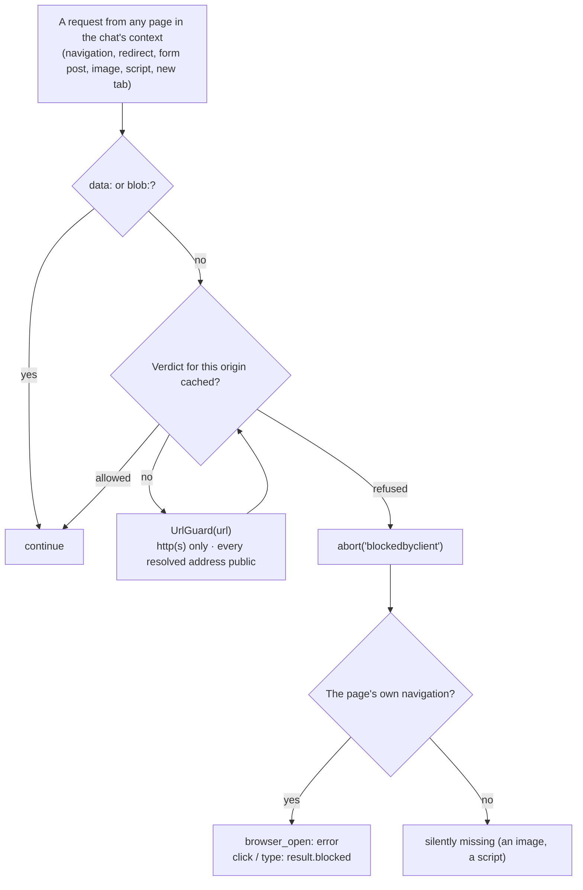
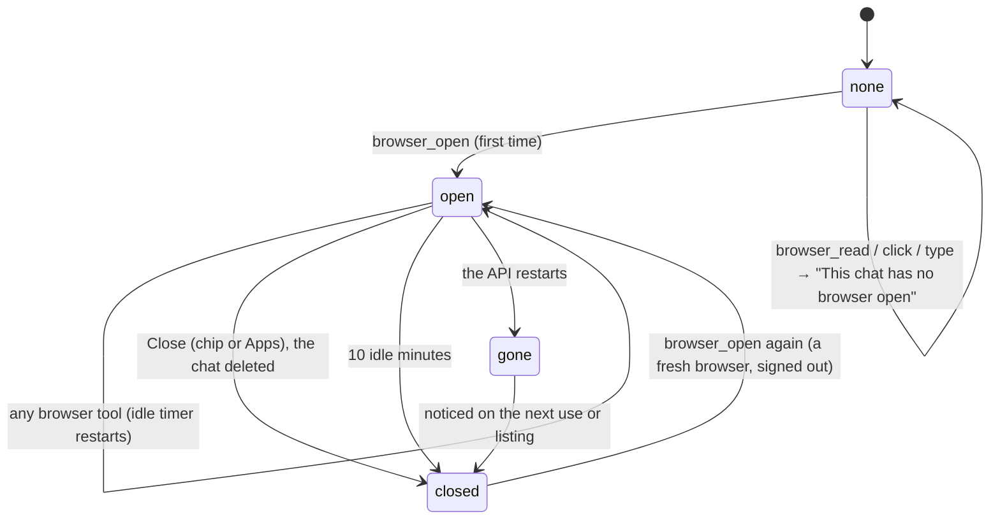

# The guard and browser states

## Every request goes through the guard

## A chat's browser

A click or a typed search that you approve after the browser has closed
gets the same "no browser open" answer, and the agent is told to open the
page again.
