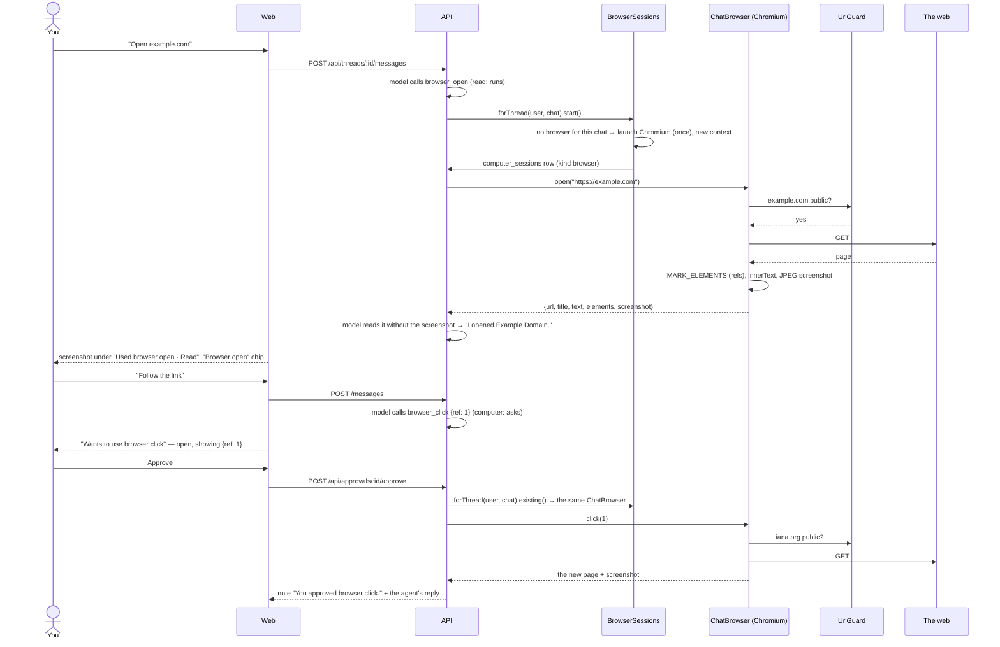

# Request flow: open, then click

If the link had pointed at a private address, the guard would have said no.
The request would be aborted, the page would stay where it was, and the
result would carry `blocked: "… is a private address. The browser did not
open it."`.
