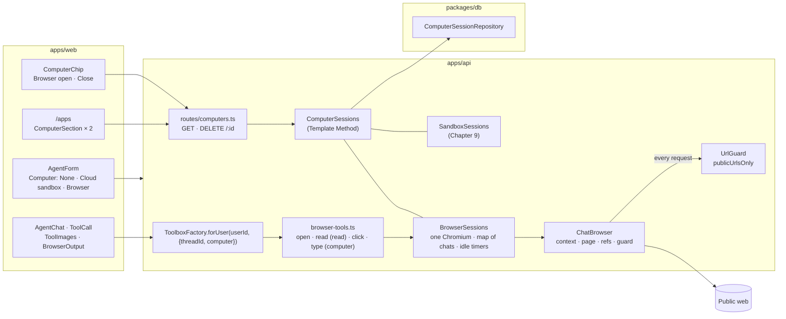

# System overview: Chapter 10

## Components

## What is new

| Piece                                                            | Role                                                                       |
| ---------------------------------------------------------------- | -------------------------------------------------------------------------- |
| `ComputerSessions`                                               | The shared base: list, stop, and stop for a chat, over `computer_sessions` |
| `BrowserSessions`                                                | Chromium, one context per chat, idle timers, a cap of 5                    |
| `ChatBrowser`                                                    | open / read / click / type, refs, the request guard, screenshots           |
| `MARK_ELEMENTS` + `pageElementsSchema`                           | Find and number what can be clicked; check what the page returned          |
| `browserTools()`                                                 | Four tools bound to one chat's browser                                     |
| `withoutImages` (`tools/model-view.ts`)                          | Charts and screenshots become notes for the model                          |
| `/api/computers`                                                 | Sandboxes and browsers, listed and stopped together                        |
| `ComputerChip`, `ComputerSection`, `ToolImages`, `BrowserOutput` | Where you see, read and stop them                                          |
