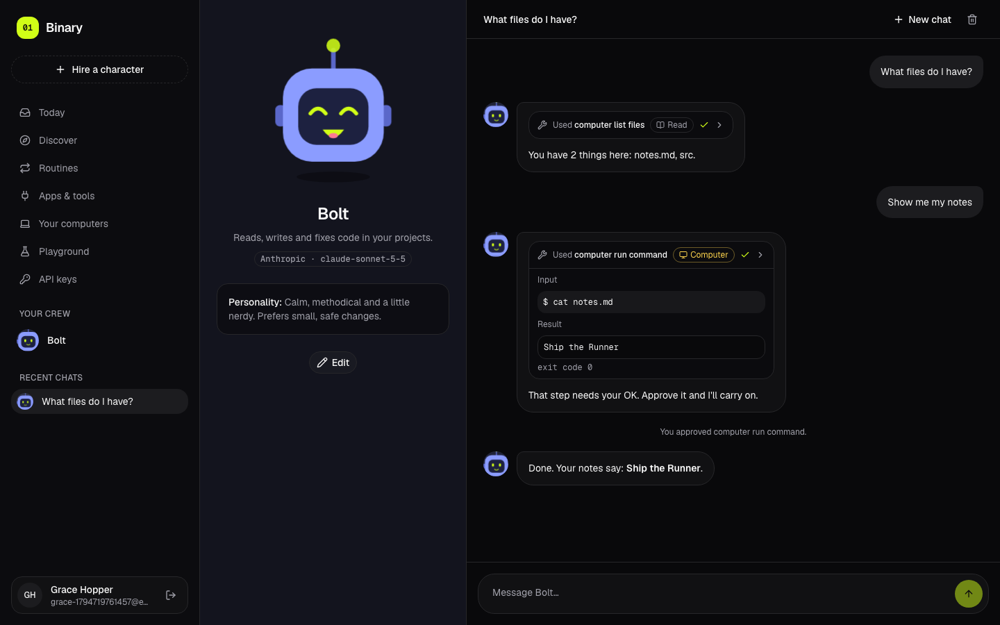
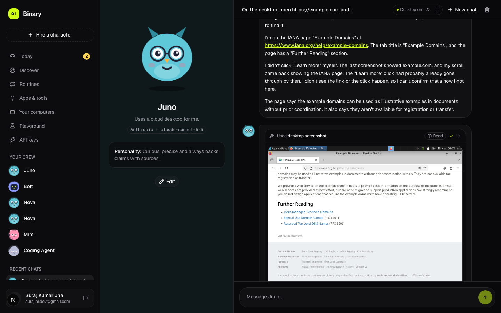

# Chapter 11: Controlling your computer with the Runner

**Goal:** characters can work on **your own computer**, with **Claude Code
or Codex** as their brain if you like, and on a **cloud desktop** you can
watch. You stay in charge:

- They only work in the folders you share.
- Anything that changes something asks first.
- One switch pauses them all.



## What you get

### The Runner (your computer)

- **Your computers** (sidebar): add a computer, and copy two commands.

  ```bash
  pnpm runner pair K7QD-3MXP                      # the one-time code (15 minutes)
  pnpm runner start --folder ~/code/my-project    # only these folders
  ```

  The page notices the pairing and the computer coming online by itself.
  It shows each computer's OS, its shared folders and whether it's
  online, and has **Pause** (the kill switch) and **Remove** buttons.

- **The Runner never accepts connections.** It asks the API for work (a
  long poll), so nothing on your computer is opened to the network.
- **It enforces the folders itself.** Every path is resolved on your
  computer, following symlinks. Anything outside the shared folders is
  refused, whatever the server asks.
- **Four tools** for a character whose Computer is **Your computer**:

  | Tool                   | Risk     |
  | ---------------------- | -------- |
  | `computer_list_files`  | Read     |
  | `computer_read_file`   | Read     |
  | `computer_run_command` | Computer |
  | `computer_write_file`  | Computer |

- **Pause** sends your computer nothing, and the character is told it's
  paused. **Remove** revokes the Runner's token, so the Runner signs out
  and stops.

### Claude Code and Codex as engines

**Thinks with** now offers **Claude Code (your computer)** and **Codex
(your computer)** next to OpenAI, Anthropic and Google:

- The Runner runs the CLI in your first shared folder, with your own
  sign-in.
- What the CLI writes, and every tool it uses ("Used Bash · Computer"),
  streams into the chat.
- The character's permission level sets how far the CLI may go:

  | Permission level                | Claude Code              | Codex                            |
  | ------------------------------- | ------------------------ | -------------------------------- |
  | Plan only                       | `--permission-mode plan` | read-only, asked for a plan only |
  | Ask first or Auto-approve reads | default (looks only)     | `--sandbox read-only`            |
  | Accept edits                    | `acceptEdits`            | `--sandbox workspace-write`      |

### Cloud desktop (E2B Desktop)

- **A full Linux desktop, one per chat.** You can **watch it live**
  (view-only) from the chat header or Apps.
- **The character really sees the screen.** Screenshots go to the model
  as images, including the screen right after a click you approved.
- **Looking, opening a page and scrolling are reads.** Clicking, typing
  and pressing keys ask first.



## Files in this chapter's docs

| File                                   | What's in it                                       |
| -------------------------------------- | -------------------------------------------------- |
| [IMPLEMENTATION.md](IMPLEMENTATION.md) | Plan, acceptance criteria, file-by-file, decisions |
| [ARCHITECTURE.md](ARCHITECTURE.md)     | The Runner protocol, engines, desktops, security   |
| [TESTING.md](TESTING.md)               | Tests, the walkthrough and the real runs           |
| [PR_REVIEW.md](PR_REVIEW.md)           | Review findings and fixes                          |
| [REBUILD_PROMPT.md](REBUILD_PROMPT.md) | Standalone prompt to rebuild this chapter          |
| [architecture/](architecture)          | Components, pairing and a job end to end, states   |
| [screenshots/](screenshots)            | Pairing, a command, Claude Code, the desktop, Apps |

## Run it

1. Apply the migration (one new column, the Runner's token hash):
   `pnpm db:migrate`.
2. Your computer:
   - Open **Your computers**, add one, then run the two commands it shows.
   - For Claude Code or Codex, install and sign in to that CLI first.
3. Cloud desktop: needs `E2B_API_KEY` in `.env`, like sandboxes.

## What comes next

Chapter 12: long-term memory and knowledge with pgvector.
