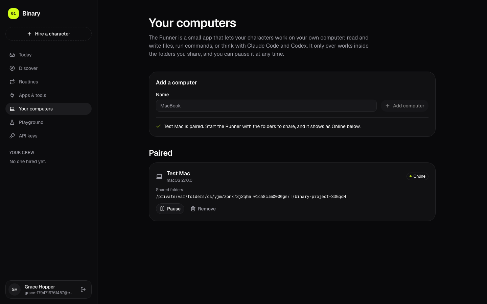
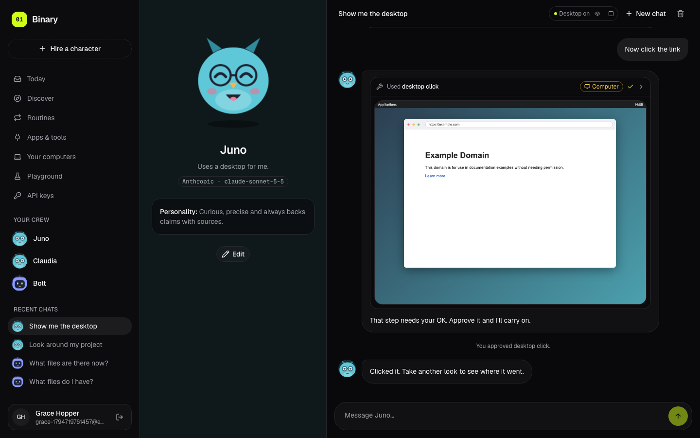

# Chapter 11: Controlling your computer with the Runner

Characters can now work on **your own computer**, inside the folders you
share, through a small local app called the Runner. They can also think with
**Claude Code** or **Codex** instead of an API model, and use a **cloud
desktop** you can watch live. Anything that changes something still asks
first.



## What you'll learn

- How a **long poll** lets a local app take work from a server without
  opening any port on your machine
- Why **the client enforces safety**: the Runner checks every path against
  your shared folders, whatever the server asks
- How **pairing** works: a one-time code, a token stored only as a hash, and
  a kill switch
- How an **external CLI** (Claude Code, Codex) becomes an engine, with your
  approval mode mapped to its permission level
- How a model **sees a screen**: desktop screenshots go to it as images

## Try it

```bash
pnpm db:migrate   # one new column for the Runner's token
pnpm dev
```

Open **Your computers** in the sidebar, add a computer, and run the two
commands it shows in a new terminal:

```bash
pnpm runner pair K7QD-3MXP                     # your one-time code
pnpm runner start --folder ~/code/my-project   # only this folder is shared
```

The page notices the computer coming online. Set a character's **Computer**
to **Your computer** and ask it what files you have. Reading runs at once;
running a command waits for your OK.


For Claude Code or Codex, install and sign in to that CLI first, then pick
it under **Thinks with**. For a cloud desktop, set `E2B_API_KEY` and choose
**Computer → Cloud desktop**; the eye icon in the chat header lets you watch it live.



## Good to know

- A command runs as you, with your environment. The shared folder is only
  where it starts, so read each command before you approve it. **Pause**
  stops everything at once.
- Runner jobs live in the API's memory, so routines running on the
  Trigger.dev worker can't reach your computer yet.
- Without `E2B_API_KEY`, there's no cloud desktop.

## Build it yourself

Paste [PROMPT.md](PROMPT.md) into your coding agent in your chapter 10 repo.
See [DIAGRAM.md](DIAGRAM.md) for how a job travels from the chat to your
computer.

## Next

[Chapter 12](../chapter-12/README.md) gives characters long-term memory and
knowledge with pgvector.
