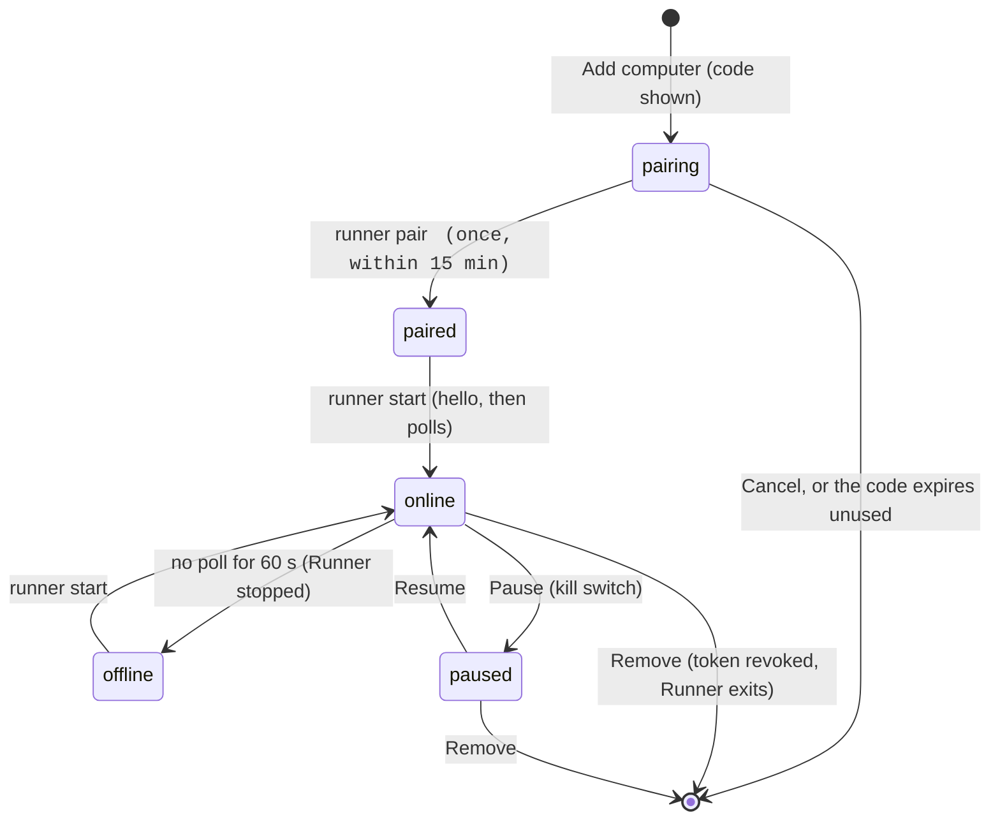
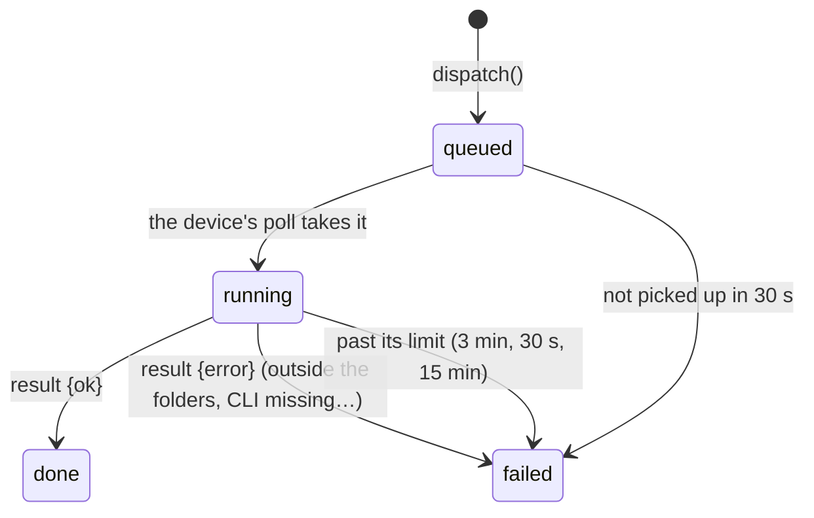
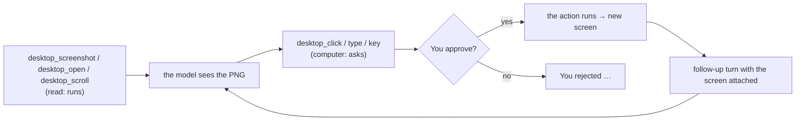

# States

## A computer (device)

## A job

Jobs live in the API's memory. One that was queued or running when the
API restarted is lost, and whoever was waiting for it gets an error.

## A desktop step

