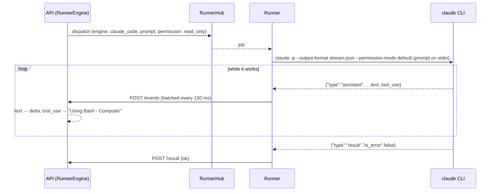

# Request flow

## Pairing, then a command you approve

```mermaid
sequenceDiagram
  actor U as You
  participant W as Web
  participant A as API
  participant H as RunnerHub
  participant R as Runner (your computer)

  U->>W: Your computers → Add "MacBook"
  W->>A: POST /api/devices
  A-->>W: code K7QD-3MXP (15 min, once)
  U->>R: pnpm runner pair K7QD-3MXP
  R->>A: POST /api/runner/pair
  A-->>R: token (saved 0600; API keeps the hash)
  U->>R: pnpm runner start --folder ~/code/app
  R->>A: POST /hello {folders}
  loop every ≤25 s
    R->>A: GET /jobs (Bearer token)
    A->>H: next(device)
  end
  W-->>U: "Online", shared folder shown

  U->>W: "Show me my notes"
  W->>A: POST /messages
  A->>A: model calls computer_run_command (computer: asks)
  W-->>U: "Wants to use computer run command" — $ cat notes.md
  U->>W: Approve
  W->>A: POST /api/approvals/:id/approve
  A->>H: dispatch(device, {command})
  H-->>R: (the waiting poll answers) {id, job}
  R->>R: folder check · /bin/sh -c "cat notes.md"
  R->>A: POST /jobs/:id/result {exitCode, stdout}
  A-->>W: note + the agent's reply
```

## Claude Code thinking


