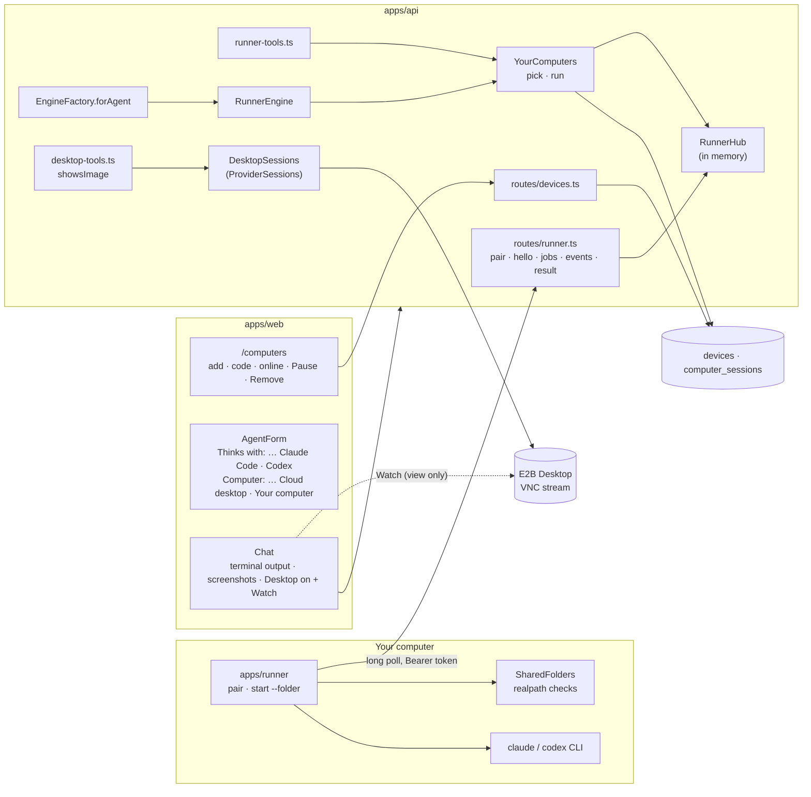

# System overview: Chapter 11

| Piece                                    | Role                                                                               |
| ---------------------------------------- | ---------------------------------------------------------------------------------- |
| `apps/runner`                            | The app on your computer: pairs, polls, runs jobs in shared folders, runs the CLIs |
| `RunnerHub`                              | Hands jobs to a device's poll; times out jobs nobody picks up                      |
| `YourComputers`                          | Picks the paired, online, unpaused computer; runs a job there                      |
| `RunnerEngine`                           | An `AgentEngine` that is Claude Code or Codex, through the Runner                  |
| `ChatComputer` / `ProviderSessions`      | Chapter 9's per-chat sandbox, made generic; sandboxes and desktops use it          |
| `DesktopSessions` + `E2BDesktopProvider` | Cloud desktops with a view-only live stream                                        |
| `withImage`, `imagesIn`, `PromptImage`   | Screenshots the model sees, during a turn and after an approval                    |
