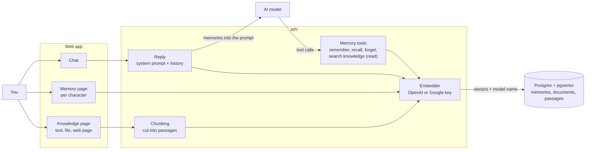

# Chapter 12 diagram

Everything goes through one embedder, built from your OpenAI or Google key.
Memories ride along with every message; knowledge is searched only when a
character uses its tool.

