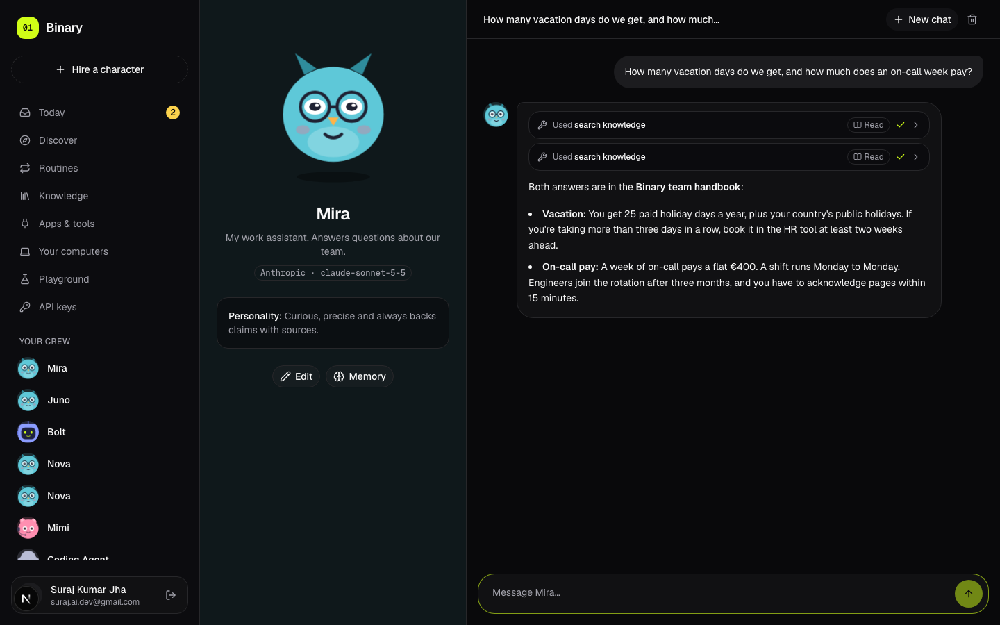

# Chapter 12: Memory and knowledge

**Goal:** characters stop starting from scratch.

- **Memory:** each character remembers lasting facts about you across
  chats.
- **Knowledge:** a library of your documents that every character can
  search by meaning and cite.

Both are stored as pgvector embeddings in Postgres; there's no new service.

## What you get

### Memory (per character)

- **Saving memories:** a character saves facts with the `remember` tool
  when you tell it something lasting ("I prefer TypeScript", "I like short
  answers"). You can also add facts yourself.
- **The Memory page** (the **Memory** button next to Edit in a chat):
  - shows every memory, marked "From a chat" or "Added by you"
  - lets you add one, or forget any
  - won't save the same thing twice ("Nova already remembers: …")
- **Memories come along by themselves:**
  - While a character has 10 memories or fewer, all of them go with every
    message.
  - Beyond that, the 5 closest in meaning to the message go.
  - Characters can also `recall` (search) and `forget`.

### Knowledge (yours, shared by all characters)

- **The Knowledge page** (sidebar): paste text, upload a text, Markdown,
  CSV or JSON file, or add a public web page. Each is cut into passages,
  embedded and saved.
- **Try a question** shows which passages a character would find, with a
  match score.
- **Characters use `search_knowledge`** before answering questions about
  your work, and name the document they used. They also say so when the
  documents don't cover something.

### Permissions

All four tools (`remember`, `recall`, `forget`, `search_knowledge`) are
**read** tools. They only touch Binary's own data, and you can see and
delete everything they save.

## Files in this chapter's docs

| File                                   | What's in it                                        |
| -------------------------------------- | --------------------------------------------------- |
| [IMPLEMENTATION.md](IMPLEMENTATION.md) | Plan, acceptance criteria, file-by-file, decisions  |
| [ARCHITECTURE.md](ARCHITECTURE.md)     | Embeddings, chunking, search, the prompt, APIs      |
| [TESTING.md](TESTING.md)               | Tests, the walkthrough and the real-model runs      |
| [PR_REVIEW.md](PR_REVIEW.md)           | Review findings and fixes                           |
| [REBUILD_PROMPT.md](REBUILD_PROMPT.md) | Standalone prompt to rebuild this chapter           |
| [architecture/](architecture)          | Components, a message end to end, adding a document |
| [screenshots/](screenshots)            | Knowledge, Memory, both in chat, real runs          |

## Run it

1. `pnpm db:migrate` (one migration: the knowledge tables, and the
   embedding model on each memory).
2. Have an **OpenAI or Google** key under API keys. Anthropic has no
   embedding models; with only an Anthropic key, memory and knowledge stay
   off and the pages say why.

## What comes next

Chapter 13: several characters working together in rooms.
