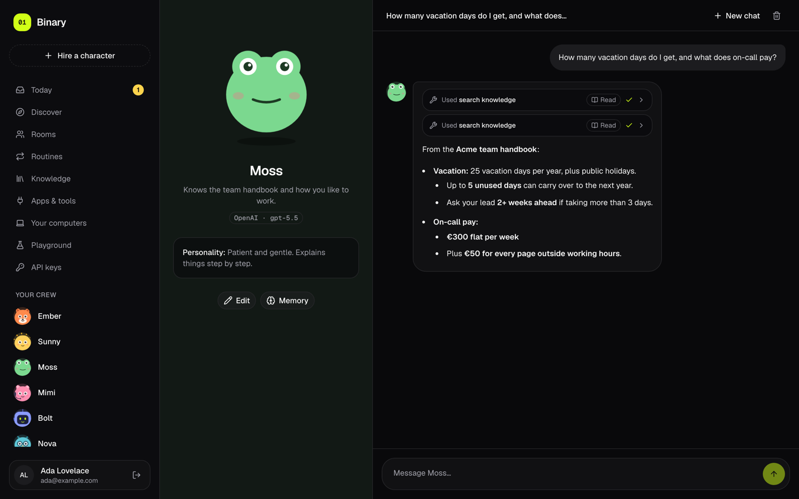
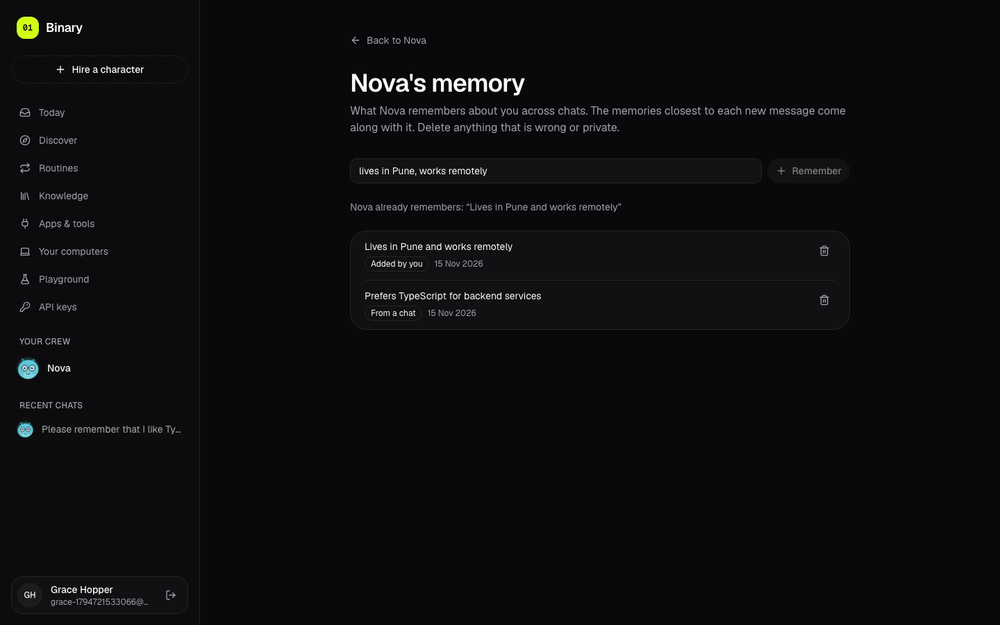

# Chapter 12: Memory and knowledge

Characters stop starting from scratch. Each one **remembers** lasting facts
about you across chats, and all of them can search a **knowledge** library
of your own documents and say which one they used. Both live in Postgres as
pgvector embeddings, so there's no new service to run.



## What you'll learn

- What an **embedding** is, and how **pgvector** finds text that is close in
  meaning, not just in words
- How **chunking** cuts a long document into passages a model can use
- The difference between **memory** (per character, about you) and
  **knowledge** (per user, shared by every character)
- Why memories go into the **system prompt** by themselves, while knowledge
  is searched with a tool
- Why vectors from two embedding models can't be compared

## Try it

```bash
pnpm db:migrate   # one new migration: the knowledge tables
pnpm dev
```

1. Add an **OpenAI** or **Google** key on **API keys**.
2. In a chat, say "Remember that I prefer short answers." The character
   saves it with its `remember` tool.
3. Start a new chat and ask something. The answer is short, without a tool
   call. Click **Memory** next to Edit to see, add or forget memories.
4. Open **Knowledge**, paste a handbook or add a public web page, and use
   **Try a question** to see which passages match.
5. Ask a character about it. It searches your knowledge and names the
   document.



## Good to know

- **Anthropic has no embedding models.** With only an Anthropic key, memory
  and knowledge stay off, and the pages say which key to add.
- If you switch from OpenAI to Google embeddings, older memories can't be
  searched any more. The Memory page tells you how many.
- All four memory and knowledge tools are `read` tools, so they never ask
  first. Everything they save is visible and deletable.

## Build it yourself

Paste [PROMPT.md](PROMPT.md) into your coding agent in your chapter 11 repo.
See [DIAGRAM.md](DIAGRAM.md) for how a message picks up memories and
knowledge.

## Next

[Chapter 13](../chapter-13/README.md) puts several characters in one chat,
as a team in a room.
