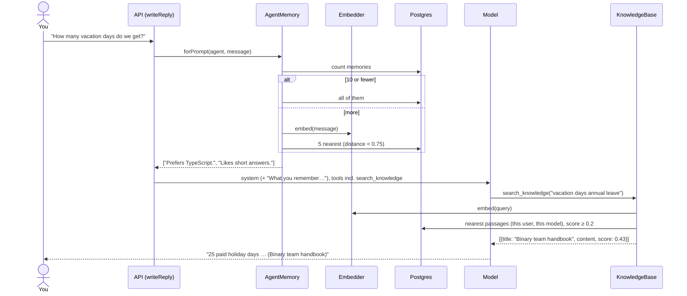

# Request flow: a message, with memory and knowledge

A `remember` call in the same way: embed the fact → find the nearest
memory → if it's closer than 0.1, answer `{alreadyKnown}`; otherwise
save it with the chat's id as its source.
