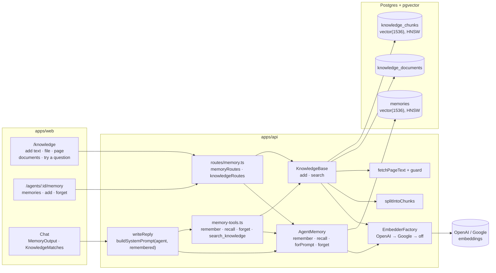

# System overview: Chapter 12

| Piece                                     | Role                                                                        |
| ----------------------------------------- | --------------------------------------------------------------------------- |
| `EmbedderFactory`                         | The user's embedding model, from an OpenAI or Google key                    |
| `AgentMemory`                             | One agent's memories: save (no duplicates), search, what goes in the prompt |
| `KnowledgeBase`                           | Documents: read or fetch, cut, embed, save; search with a score cutoff      |
| `MemoryRepository`, `KnowledgeRepository` | Postgres with `cosineDistance`                                              |
| `memoryTools`                             | Four read tools for every agent, when an embedding key exists               |
